# Architecture

## System Overview

Happy Calendar is built as a full-stack web application with a clear separation of concerns between the frontend user interface, the backend API, and the database layer. The system is designed for scalability, maintainability, and user experience.

## High-Level Architecture

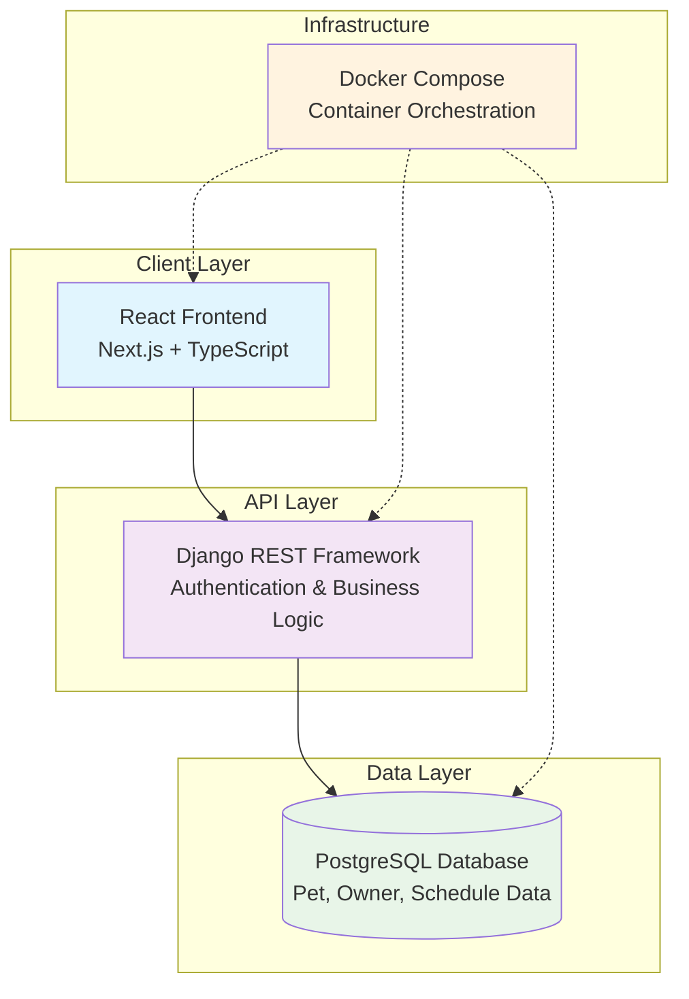

## Component Architecture

### Frontend Architecture

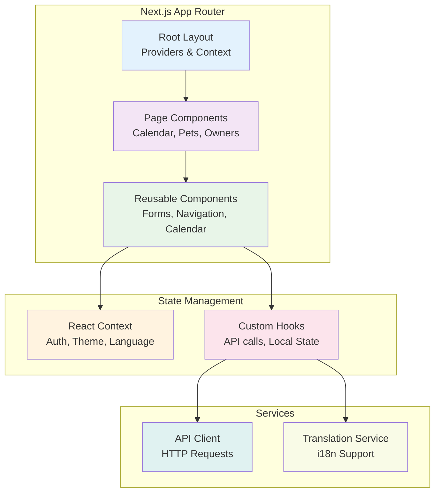

### Backend Architecture

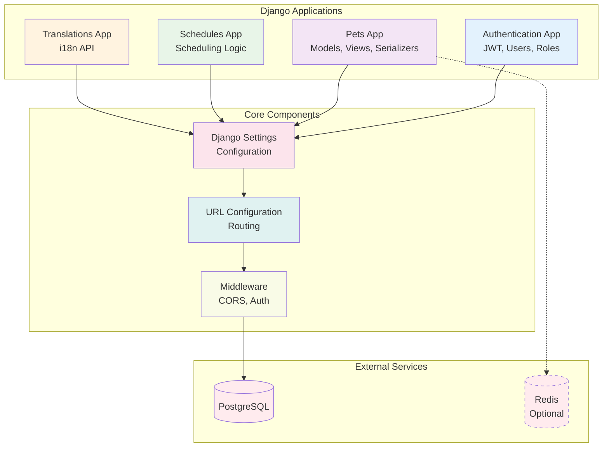

## Data Flow Architecture

### User Interaction Flow

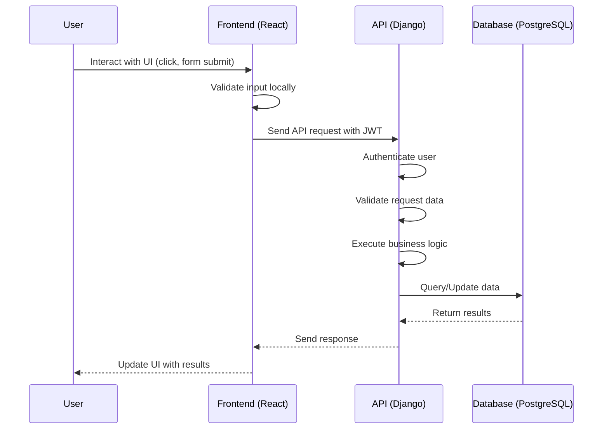

### Scheduling Flow with Conflict Detection

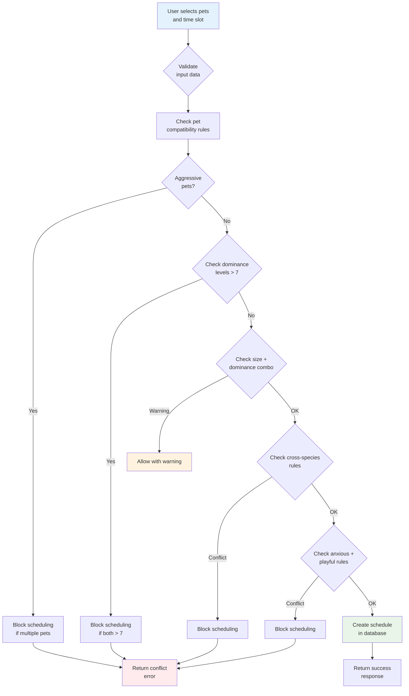

## Database Schema

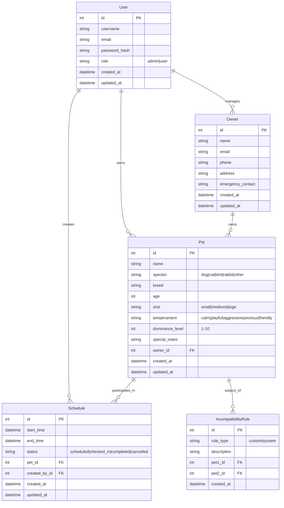

## Authentication Flow

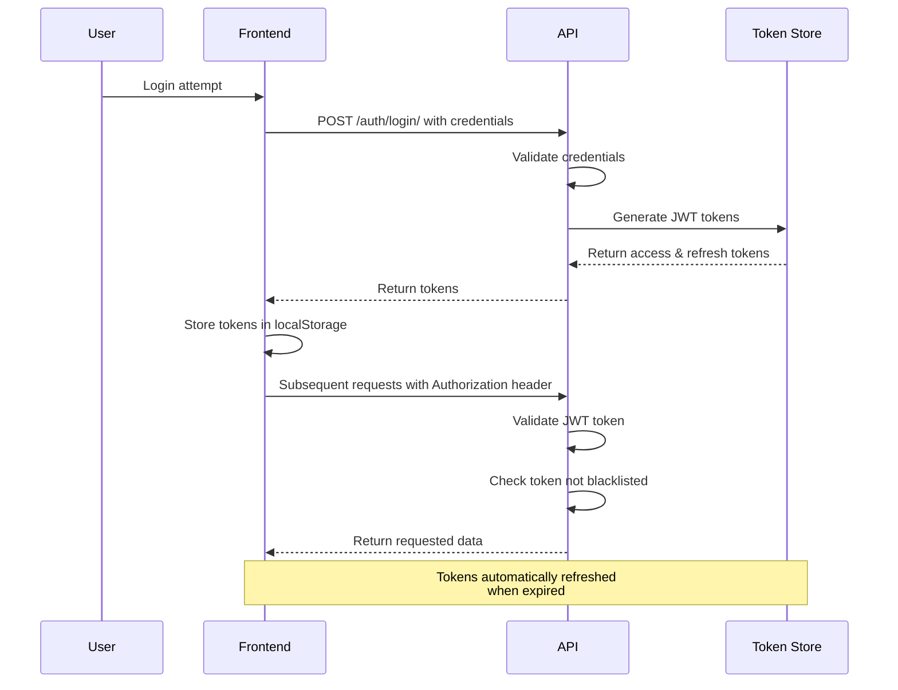

## Conflict Detection Algorithm

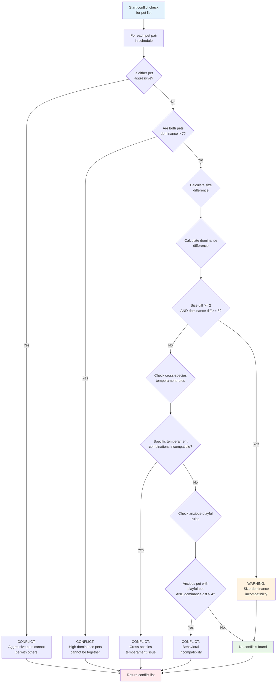

## API Layer Architecture

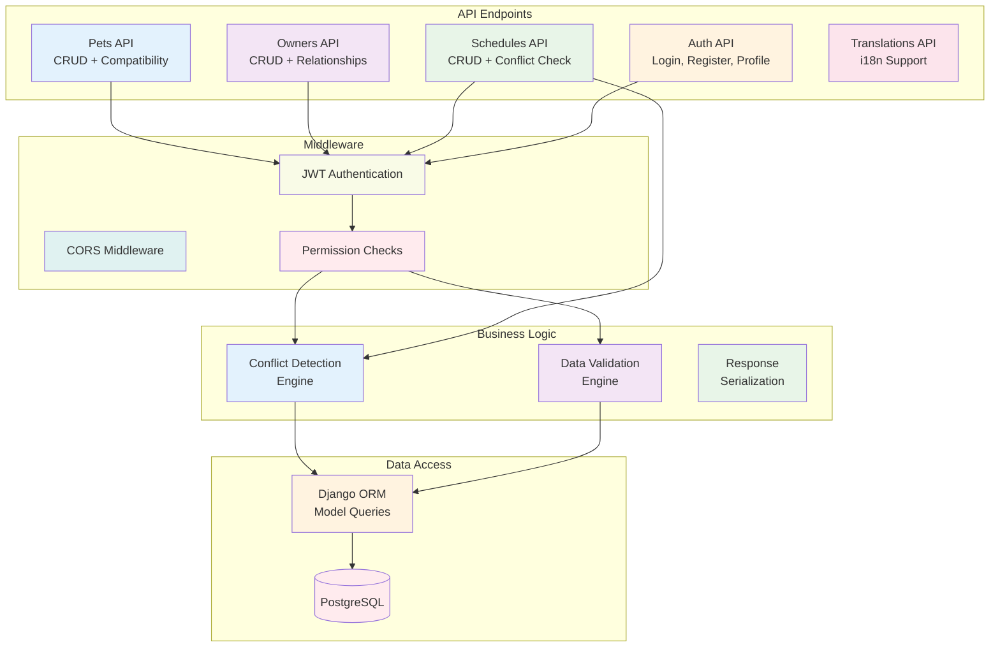

## Deployment Architecture

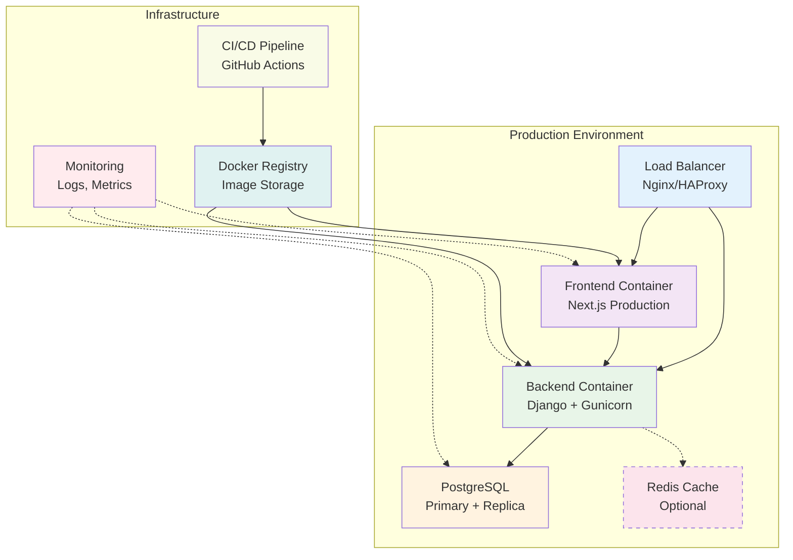

## Component Interaction Details

### Frontend-Backend Communication

The frontend communicates with the backend through RESTful APIs using JSON payloads. All requests include JWT authentication headers for secure communication.

**Request Flow:**
1. User action triggers state change in React component
2. Component calls custom hook for API interaction
3. Hook uses Axios client to make HTTP request
4. Request includes Authorization header with JWT token
5. Backend validates token and processes request
6. Response data updates component state
7. UI re-renders with new data

### Conflict Detection Integration

The conflict detection engine is tightly integrated into the scheduling workflow:

1. **Pre-validation**: Input data validated before conflict checking
2. **Rule Application**: Multiple rules applied in sequence for comprehensive coverage
3. **Performance Optimization**: Rules ordered by computational cost and likelihood
4. **Result Aggregation**: All conflicts collected and returned with detailed messages
5. **Caching**: Rule results cached for repeated validations

### Internationalization Pipeline

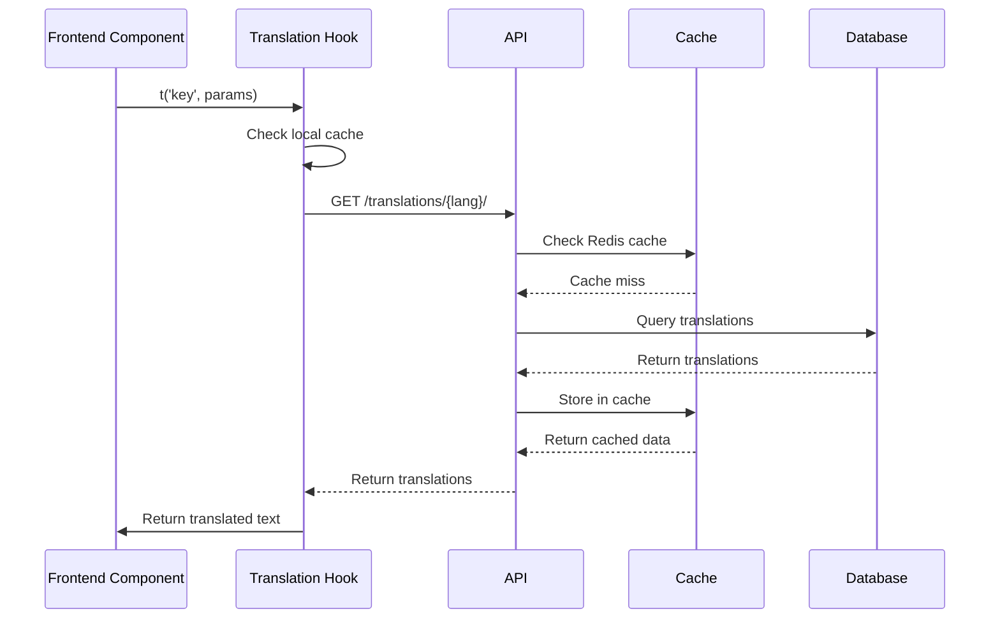

This architecture ensures efficient translation loading and caching while maintaining real-time language switching capabilities.

## Security Considerations

### Authentication Security
- JWT tokens with expiration and refresh mechanism
- Token blacklisting for logout
- Password hashing with secure algorithms
- Role-based access control

### API Security
- CORS configuration for allowed origins
- Input validation and sanitization
- SQL injection prevention through ORM
- Rate limiting (recommended for production)

### Data Security
- Encrypted database connections
- Secure password storage
- Audit logging for sensitive operations
- Data backup and recovery procedures

## Performance Optimizations

### Frontend Optimizations
- Code splitting with Next.js dynamic imports
- Image optimization and lazy loading
- Memoization of expensive calculations
- Efficient state management

### Backend Optimizations
- Database query optimization with select_related/prefetch_related
- API response caching
- Background task processing for heavy operations
- Database indexing on frequently queried fields

### Infrastructure Optimizations
- Container resource limits
- Horizontal scaling capabilities
- CDN for static assets
- Database connection pooling
