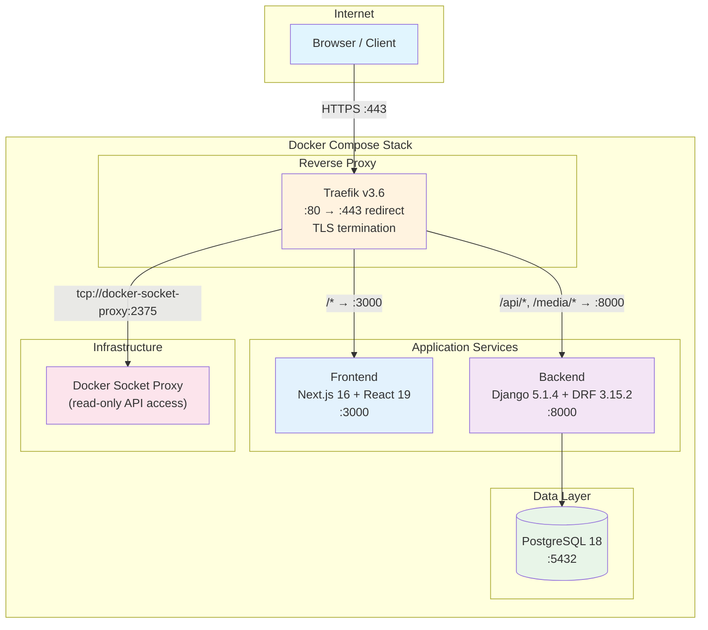
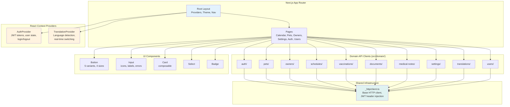
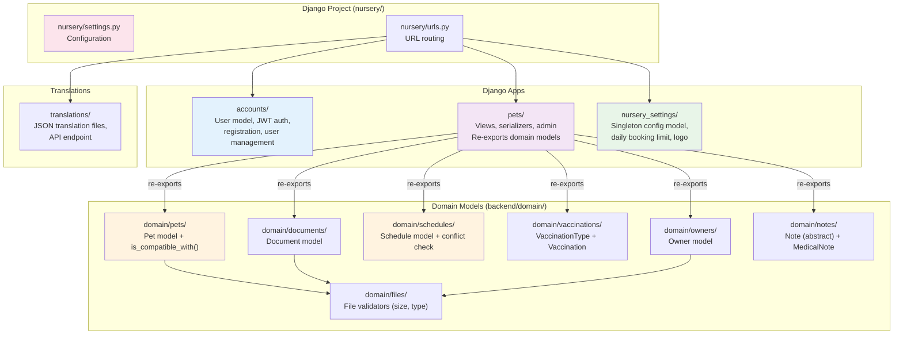
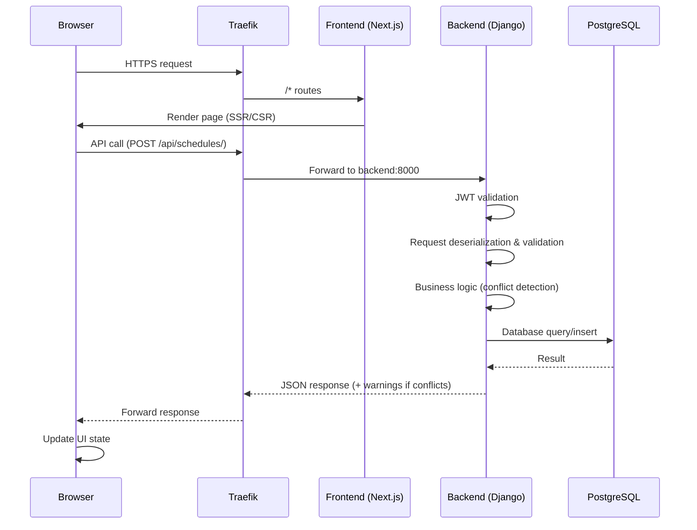
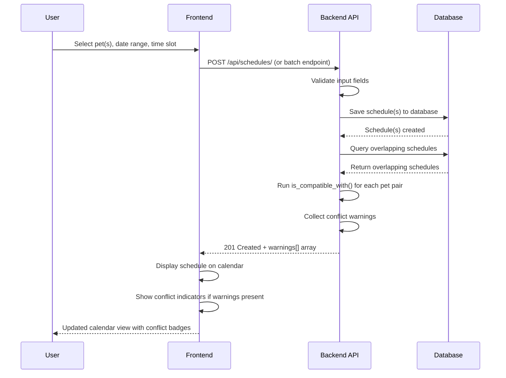
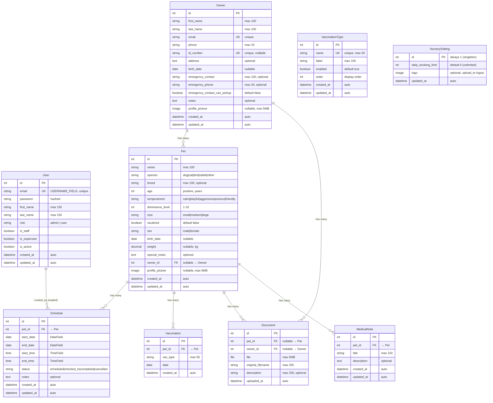
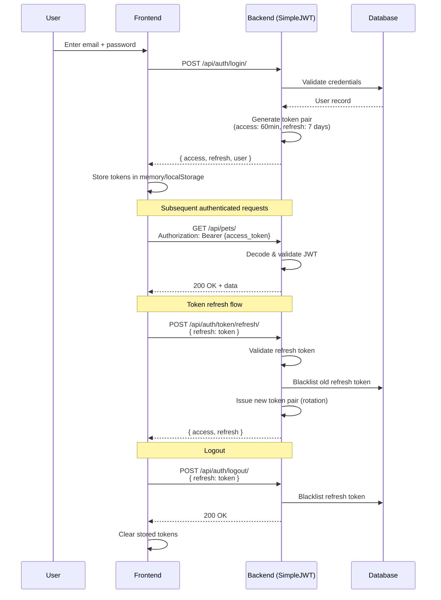
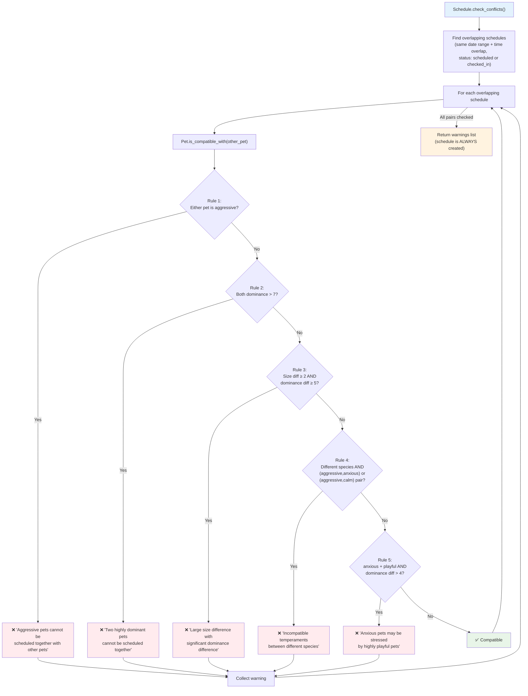
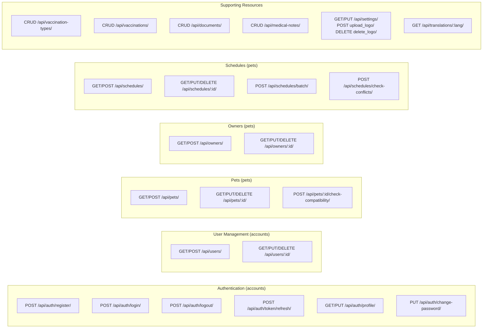
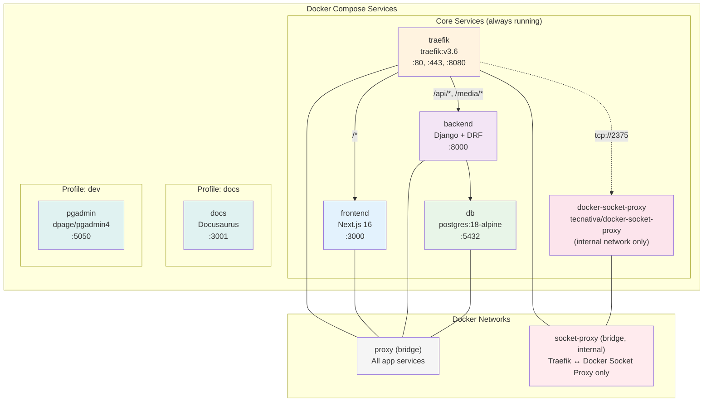

# Architecture

## System Overview

Happy Calendar is a full-stack web application with a clear three-tier architecture: a **Next.js 16** frontend, a **Django 5.1.4** REST API backend, and a **PostgreSQL 18** database. All services are containerized with Docker Compose and routed through a **Traefik v3.6** reverse proxy that handles TLS termination and path-based routing.

There is no external caching layer (no Redis). All state lives in PostgreSQL. Authentication uses stateless JWT tokens with server-side blacklisting for revocation.

---

## High-Level Architecture

### Routing Rules

| Path Pattern | Target Service | Port |
|---|---|---|
| `/api/*` | backend | 8000 |
| `/media/*` | backend | 8000 |
| `/*` (catch-all) | frontend | 3000 |

All HTTP traffic on port 80 is permanently redirected to HTTPS on port 443.

---

## Component Architecture

### Frontend Architecture

The frontend uses the **Next.js App Router** with **React 19** and **TypeScript 5.7**. State is managed through React Context providers and custom hooks. API communication is organized into domain-sliced modules.

**Key design decisions:**

- **Domain-sliced API clients**: Each domain (`pets/`, `owners/`, `schedules/`, etc.) has its own `api.ts` and `types.ts` under `src/domain/`, keeping API logic co-located with type definitions
- **Centralized HTTP client**: `src/domain/_http/client.ts` handles base URL configuration and JWT `Authorization` header injection
- **Context-based state**: `AuthProvider` manages authentication state (tokens, user info, login/logout); `TranslationProvider` manages i18n (language detection, switching, caching)
- **No external state library**: State management uses React Context and hooks — no Redux, Zustand, or similar

### Backend Architecture

The backend is a **Django 5.1.4** project with **3 Django apps** and a **domain model package**:

**Key design decisions:**

- **Domain model package**: All business models live in `backend/domain/` (owners, pets, schedules, vaccinations, documents, notes, files), each with `app_label = 'pets'` so Django manages them under a single migration history
- **Model re-export**: `pets/models.py` re-exports all domain models, making them accessible via `pets.Owner`, `pets.Pet`, `pets.Schedule`, etc.
- **Singleton settings**: `NurserySetting` enforces `pk=1` in its `save()` method, ensuring exactly one configuration row
- **No separate schedules app**: Schedules are a domain model under `domain/schedules/`, with views handled by `pets/views.py`

---

## Data Flow

### Standard API Request Flow

### Schedule Creation with Conflict Detection

---

## Database Schema

### Model Details

| Model | App Label | Location | Notes |
|---|---|---|---|
| `User` | `accounts` | `accounts/models.py` | Extends `AbstractUser`, `username = None`, `USERNAME_FIELD = 'email'` |
| `Owner` | `pets` | `domain/owners/models.py` | Unique email, unique id_number |
| `Pet` | `pets` | `domain/pets/models.py` | `is_compatible_with()` method implements conflict rules |
| `Schedule` | `pets` | `domain/schedules/models.py` | Separate `DateField` + `TimeField` (not `DateTimeField`) |
| `VaccinationType` | `pets` | `domain/vaccinations/models.py` | Configurable types with enable/disable and ordering |
| `Vaccination` | `pets` | `domain/vaccinations/models.py` | Links pet to a vaccination type string + date |
| `Document` | `pets` | `domain/documents/models.py` | Polymorphic: links to either Pet or Owner (not both) |
| `Note` | — | `domain/notes/models.py` | Abstract base model (title + description + timestamps) |
| `MedicalNote` | `pets` | `domain/notes/models.py` | Concrete model extending `Note`, linked to Pet |
| `NurserySetting` | `nursery_settings` | `nursery_settings/models.py` | Singleton (`pk=1` enforced in `save()`). Stores `daily_booking_limit` and `logo` (ImageField). |

---

## Authentication Flow

### Authentication Details

- **No username**: The `User` model sets `username = None` and `USERNAME_FIELD = 'email'`
- **Access token lifetime**: 60 minutes
- **Refresh token lifetime**: 7 days
- **Token rotation**: Each refresh request issues a new token pair and blacklists the old refresh token
- **Roles**: `admin` and `user` — stored as a `CharField` with `TextChoices`
- **Admin capabilities**: User CRUD, role assignment, account deactivation

---

## Conflict Detection Algorithm

The conflict detection logic lives in two methods on the domain models:

1. **`Pet.is_compatible_with(other_pet)`** — Pairwise compatibility check
2. **`Schedule.check_conflicts()`** — Finds overlapping schedules and runs compatibility checks

### Size Mapping for Rule 3

| Size | Numeric Value |
|---|---|
| small | 1 |
| medium | 2 |
| large | 3 |

Size difference is calculated as `abs(size_order[pet_a] - size_order[pet_b])`. A difference ≥ 2 (e.g., small vs. large) combined with dominance difference ≥ 5 triggers the rule.

### Key Principle: Non-Blocking Conflicts

Conflicts are **warnings, not errors**. The schedule is always saved to the database regardless of compatibility results. The API response includes a `warnings` array so the frontend can display conflict indicators without preventing the booking.

---

## API Layer

### Endpoint Structure

### API Documentation Endpoints

| Endpoint | Format | Description |
|---|---|---|
| `/api/docs/` | Swagger UI | Interactive API explorer |
| `/api/redoc/` | ReDoc | Alternative documentation viewer |
| `/api/schema/` | OpenAPI 3.0 JSON | Machine-readable schema (generated by drf-spectacular) |

### Middleware Pipeline

All API requests pass through:

1. **Traefik**: TLS termination, path-based routing
2. **Django CORS Middleware** (`django-cors-headers`): Cross-origin request handling
3. **JWT Authentication** (`djangorestframework-simplejwt`): Token validation and user resolution
4. **DRF Permission Classes**: Role-based access control (admin vs. user)
5. **DRF Serializers**: Request validation and response serialization

---

## Deployment Architecture

### Service Configuration

| Service | Image / Build | Port | Network | Profile |
|---|---|---|---|---|
| `db` | `postgres:18-alpine` | 5432 (internal) | proxy | — |
| `backend` | `./backend` (Dockerfile) | 8000 (via Traefik) | proxy | — |
| `frontend` | `./frontend` (Dockerfile) | 3000 (via Traefik) | proxy | — |
| `traefik` | `traefik:v3.6` | 80, 443, 8080 | proxy, socket-proxy | — |
| `docker-socket-proxy` | `tecnativa/docker-socket-proxy` | 2375 (internal) | socket-proxy | — |
| `docs` | `./docs` (Dockerfile) | 3001 | — | `docs` |
| `pgadmin` | `dpage/pgadmin4` | 5050 | proxy | `dev` |

### TLS Configuration

- **Default**: Self-signed TLS certificate (Traefik's built-in fallback)
- **Production**: Let's Encrypt via Cloudflare DNS challenge (requires `CF_DNS_API_TOKEN` and `ACME_EMAIL` environment variables)
- **HTTP → HTTPS**: Global permanent redirect from port 80 to 443

### Docker Network Security

- **`proxy` network**: Standard bridge network for inter-service communication (frontend, backend, db, traefik, pgadmin)
- **`socket-proxy` network**: Internal bridge network (`internal: true` — no outbound internet access) connecting only Traefik and the Docker Socket Proxy
- **Docker Socket Proxy**: Grants Traefik **read-only** access to specific Docker API endpoints (containers, services, networks, events) while explicitly blocking all write operations

### Volumes

| Volume | Purpose |
|---|---|
| `postgres_data` | Persistent PostgreSQL data |
| `traefik-certs` | Persistent Let's Encrypt certificates |
