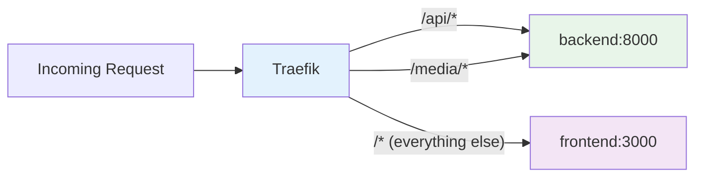

# Deployment

## Overview

Happy Calendar runs as a set of Docker containers orchestrated by Docker Compose, with Traefik as the reverse proxy handling routing, TLS termination, and HTTP-to-HTTPS redirection. The stack consists of a PostgreSQL database, a Django backend, a Next.js frontend, and optional documentation and pgAdmin services.

## Prerequisites

- **Docker** version 20.10+
- **Docker Compose** version 2.0+
- **Make** (for the Makefile commands)
- **Operating System**: Linux, macOS, or Windows with WSL2
- Ports **80**, **443**, and **8080** available on the host

## Quick Start

```bash
# Clone the repository
git clone <repository-url>
cd happy-calendar

# First-time setup: build, start, migrate, and create admin user
make init
```

That's it. `make init` runs the full initialization sequence — building images, starting containers, running database migrations, and creating the default admin user.

## Access URLs (Local Development)

| Service | URL | Notes |
|---|---|---|
| **Frontend** | `https://localhost` | Via Traefik (self-signed TLS) |
| **Backend API** | `https://localhost/api/` | Via Traefik |
| **Swagger UI** | `https://localhost/api/docs/` | Interactive API docs |
| **ReDoc** | `https://localhost/api/redoc/` | Alternative API docs |
| **Traefik Dashboard** | `http://localhost:8080` | Traefik admin UI |
| **Documentation** | `http://localhost:3001` | Requires `--profile docs` |
| **pgAdmin** | `http://localhost:5050` | Requires `--profile dev` |

> **Note:** Local development uses a self-signed TLS certificate. Your browser will show a security warning — this is expected. Accept the certificate to proceed.

## Docker Architecture


## Services

### `db` — PostgreSQL Database

- **Image**: `postgres:16-alpine`
- **Environment**: `POSTGRES_DB=nursery`, `POSTGRES_USER=nursery`, `POSTGRES_PASSWORD=nursery`
- **Volume**: `postgres_data` mounted to `/var/lib/postgresql/data`
- **Healthcheck**: `pg_isready` command to verify the database is accepting connections
- **Network**: `proxy`

### `backend` — Django API Server

- **Build context**: `./backend`
- **Environment variables**: `DEBUG`, `DJANGO_SECRET_KEY`, `POSTGRES_DB`, `POSTGRES_USER`, `POSTGRES_PASSWORD`, `POSTGRES_HOST`, `POSTGRES_PORT`
- **Volume**: `./backend:/app` (live code reload in development)
- **Depends on**: `traefik`, `db` (with `condition: service_healthy`)
- **Command**: Runs migrations then starts the Django development server
- **Traefik labels**: Routes `/api/*` and `/media/*` to `backend:8000`

### `frontend` — Next.js Application

- **Build context**: `./frontend`
- **Environment**: `NEXT_PUBLIC_API_URL`
- **Depends on**: `traefik`, `backend`
- **Traefik labels**: Routes `/*` (catch-all) to `frontend:3000`

### `docs` — Documentation Site

- **Build context**: `./docs`
- **Port**: `3001:3000`
- **Profile**: `docs` — only starts when explicitly requested with `--profile docs`

### `pgadmin` — Database Admin UI

- **Image**: `dpage/pgadmin4`
- **Port**: `5050:80`
- **Profile**: `dev` — only starts when explicitly requested with `--profile dev`

### `docker-socket-proxy` — Secure Docker API Access

- **Image**: `tecnativa/docker-socket-proxy`
- **Purpose**: Provides read-only Docker API access to Traefik, avoiding the need to mount the Docker socket directly into the Traefik container (security best practice).
- **Network**: `socket-proxy` (internal)

### `traefik` — Reverse Proxy & TLS

- **Image**: `traefik:v3.6`
- **Ports**: `8080` (dashboard), `80` (HTTP), `443` (HTTPS)
- **Features**:
  - HTTP → HTTPS redirection
  - Self-signed TLS certificate as fallback for local development
  - Let's Encrypt support via Cloudflare DNS challenge for production (configured via `CF_DNS_API_TOKEN` and `ACME_EMAIL` environment variables)
- **Networks**: `proxy`, `socket-proxy`

## Networks

| Network | Type | Purpose |
|---|---|---|
| `proxy` | bridge | Main network connecting all application services and Traefik |
| `socket-proxy` | internal, bridge | Isolated network for secure Docker socket access between Traefik and docker-socket-proxy |

## Volumes

| Volume | Purpose |
|---|---|
| `postgres_data` | Persistent PostgreSQL data |
| `traefik-certs` | TLS certificates (Let's Encrypt and self-signed) |

## Environment Variables

### Backend

| Variable | Description | Default |
|---|---|---|
| `DEBUG` | Django debug mode | `True` (development) |
| `DJANGO_SECRET_KEY` | Django secret key | Set in compose file |
| `POSTGRES_DB` | Database name | `nursery` |
| `POSTGRES_USER` | Database user | `nursery` |
| `POSTGRES_PASSWORD` | Database password | `nursery` |
| `POSTGRES_HOST` | Database host | `db` |
| `POSTGRES_PORT` | Database port | `5432` |

### Frontend

| Variable | Description | Default |
|---|---|---|
| `NEXT_PUBLIC_API_URL` | Backend API base URL | Set via Docker Compose |

### Docker Compose / Traefik

| Variable | Description | Usage |
|---|---|---|
| `DOMAIN` | Production domain name | Traefik routing rules |
| `NEXT_PUBLIC_API_URL` | API URL passed to frontend | Frontend build |
| `CF_DNS_API_TOKEN` | Cloudflare DNS API token | Let's Encrypt DNS challenge |
| `ACME_EMAIL` | Email for Let's Encrypt | Certificate registration |
| `DOCKER_SOCKET` | Path to Docker socket | docker-socket-proxy mount |

## Routing

Traefik handles all incoming HTTP/HTTPS traffic and routes based on path:



- All requests to `/api/*` and `/media/*` are proxied to the Django backend.
- All other requests are proxied to the Next.js frontend.
- HTTP requests on port 80 are automatically redirected to HTTPS on port 443.

## Makefile Commands

The project includes a comprehensive Makefile in the repository root for common operations.

### Setup & Lifecycle

| Command | Description |
|---|---|
| `make init` | First-time setup: build, up, migrate, create-admin |
| `make build` | Build all Docker images |
| `make up` | Start all services |
| `make down` | Stop all services |
| `make restart` | Restart all services |
| `make rebuild` | Rebuild and restart all services |
| `make clean` | Stop services and remove volumes |
| `make status` | Show status of all containers |

### Logs

| Command | Description |
|---|---|
| `make logs` | Follow logs for all services |
| `make logs-backend` | Follow backend logs only |
| `make logs-frontend` | Follow frontend logs only |
| `make logs-db` | Follow database logs only |

### Shell Access

| Command | Description |
|---|---|
| `make shell-backend` | Open a shell in the backend container |
| `make shell-frontend` | Open a shell in the frontend container |
| `make shell-db` | Open a psql shell in the database container |

### Database

| Command | Description |
|---|---|
| `make migrate` | Run Django database migrations |
| `make makemigrations` | Generate new migration files |
| `make createsuperuser` | Create a Django superuser interactively |
| `make create-admin` | Create the default admin user |

### Testing

| Command | Description |
|---|---|
| `make test` | Run all tests (backend + frontend) |
| `make test-backend` | Run backend tests only |
| `make test-frontend` | Run frontend Playwright E2E tests |
| `make test-frontend-debug` | Run frontend tests with Playwright UI |
| `make test-coverage` | Run tests with coverage reporting |

### Code Quality

| Command | Description |
|---|---|
| `make lint` | Run linters on all code |
| `make format` | Auto-format all code |

## Database Management

### Migrations

Migrations run automatically as part of the backend container startup command. To run them manually:

```bash
make migrate              # Apply pending migrations
make makemigrations       # Generate new migration files
```

### Backup & Restore

```bash
# Backup the database
docker compose exec db pg_dump -U nursery nursery > backup.sql

# Restore from backup
docker compose exec -T db psql -U nursery nursery < backup.sql
```

### Reset Database

```bash
# Stop everything and remove volumes (destroys all data)
make clean

# Rebuild from scratch
make init
```

## Production Deployment

### TLS with Let's Encrypt

For production, configure automatic TLS certificates via Cloudflare DNS challenge:

1. Set the required environment variables:
   ```bash
   export DOMAIN=yourdomain.com
   export ACME_EMAIL=admin@yourdomain.com
   export CF_DNS_API_TOKEN=your-cloudflare-api-token
   ```

2. Traefik will automatically obtain and renew certificates from Let's Encrypt using the Cloudflare DNS challenge. Certificates are stored in the `traefik-certs` volume.

3. If no Cloudflare token is configured, Traefik falls back to a self-signed certificate.

### Security Considerations

- **Django secret key**: Always set a unique `DJANGO_SECRET_KEY` in production. Never use the default development key.
- **Database password**: Change `POSTGRES_PASSWORD` from the default `nursery` value.
- **Debug mode**: Ensure `DEBUG=False` in production.
- **Docker socket**: The `docker-socket-proxy` provides read-only API access to Traefik, avoiding direct Docker socket mounting.

## Optional Services

### Documentation Site

Start the documentation site alongside the main stack:

```bash
docker compose --profile docs up
```

Access at `http://localhost:3001`.

### pgAdmin

Start pgAdmin for database administration:

```bash
docker compose --profile dev up
```

Access at `http://localhost:5050`.

## Troubleshooting

### Database Connection Failed

```bash
# Check database health
make status

# View database logs
make logs-db

# Restart database
docker compose restart db
```

### Backend Won't Start

```bash
# Check backend logs for errors
make logs-backend

# Open a shell to debug
make shell-backend

# Re-run migrations manually
make migrate
```

### Frontend Build Issues

```bash
# Check frontend logs
make logs-frontend

# Open a shell to debug
make shell-frontend

# Full rebuild
make rebuild
```

### Port Conflicts

If ports 80, 443, or 8080 are already in use:

```bash
# Find what's using the ports
sudo lsof -i :80
sudo lsof -i :443
sudo lsof -i :8080

# Stop conflicting services before starting the stack
make up
```

### Full Reset

When all else fails, perform a complete reset:

```bash
make clean    # Stop everything and remove volumes
make init     # Rebuild from scratch
```

## Monitoring & Logs

The project relies on Docker's built-in logging. Use the Makefile log commands for day-to-day monitoring:

```bash
make logs            # All services
make logs-backend    # Backend only
make logs-frontend   # Frontend only
make logs-db         # Database only
```

For container resource usage:

```bash
docker stats
```

The Traefik dashboard at `http://localhost:8080` provides real-time information about routing rules, active services, and middleware.
