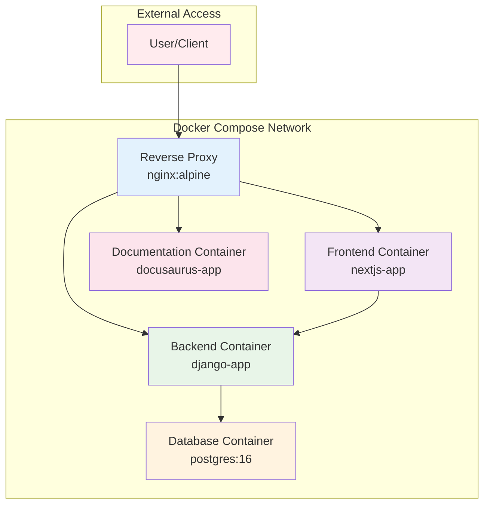

# Deployment

## Overview

Happy Calendar is designed for easy deployment using Docker and Docker Compose. The application consists of multiple services that work together to provide a complete pet nursery scheduling solution.

## Prerequisites

### System Requirements

- **Docker**: Version 20.10 or later
- **Docker Compose**: Version 2.0 or later
- **Operating System**: Linux, macOS, or Windows with WSL2
- **RAM**: Minimum 4GB, recommended 8GB
- **Storage**: Minimum 5GB free space

### Network Requirements

- **Ports**: Ensure ports 3000 (frontend), 8000 (backend), and 5432 (database) are available
- **Internet Access**: Required for initial setup and package downloads

## Quick Start

### Development Environment

1. **Clone the repository**:
   ```bash
   git clone https://github.com/your-username/happy-calendar.git
   cd happy-calendar
   ```

2. **Start all services**:
   ```bash
   docker-compose up --build
   ```

3. **Wait for initialization**:
   - First run may take 5-10 minutes to download images and install dependencies
   - Database migrations run automatically
   - Superuser account is created automatically (admin/admin123)

4. **Access the application**:
   - **Frontend**: http://localhost:3000
   - **Backend API**: http://localhost:8000/api/
   - **API Documentation**: http://localhost:8000/api/docs/
   - **Admin Panel**: http://localhost:8000/admin/

### Production Environment

For production deployment, additional configuration is required:

```bash
# Set environment variables
export DJANGO_SECRET_KEY="your-secure-secret-key-here"
export POSTGRES_PASSWORD="secure-database-password"

# Use production docker-compose
docker-compose -f docker-compose.prod.yml up --build -d
```

## Docker Architecture



## Service Configuration

### Docker Compose File

```yaml
version: '3.8'

services:
  db:
    image: postgres:16
    environment:
      POSTGRES_DB: nursery
      POSTGRES_USER: nursery
      POSTGRES_PASSWORD: nursery
    volumes:
      - postgres_data:/var/lib/postgresql/data
    healthcheck:
      test: ["CMD-SHELL", "pg_isready -U nursery"]
      interval: 10s
      timeout: 5s
      retries: 5

  backend:
    build:
      context: ./backend
      dockerfile: Dockerfile
    environment:
      DEBUG: "True"
      DJANGO_SECRET_KEY: "dev-key-change-in-production"
      POSTGRES_DB: nursery
      POSTGRES_USER: nursery
      POSTGRES_PASSWORD: nursery
      POSTGRES_HOST: db
      POSTGRES_PORT: 5432
    volumes:
      - ./backend:/app
    depends_on:
      db:
        condition: service_healthy
    ports:
      - "8000:8000"
    command: python manage.py runserver 0.0.0.0:8000

  frontend:
    build:
      context: ./frontend
      dockerfile: Dockerfile
    environment:
      NEXT_PUBLIC_API_URL: "http://localhost:8000/api"
    volumes:
      - ./frontend:/app
      - /app/node_modules
    depends_on:
      - backend
    ports:
      - "3000:3000"
    command: npm run dev

  docs:
    build:
      context: ./docs
      dockerfile: Dockerfile
    ports:
      - "3001:3000"
    command: npm start

volumes:
  postgres_data:
```

### Individual Dockerfiles

#### Backend Dockerfile

```dockerfile
FROM python:3.11-slim

ENV PYTHONDONTWRITEBYTECODE=1
ENV PYTHONUNBUFFERED=1

WORKDIR /app

# Install system dependencies
RUN apt-get update \
    && apt-get install -y gcc postgresql-client \
    && rm -rf /var/lib/apt/lists/*

# Install Python dependencies
COPY requirements.txt .
RUN pip install --no-cache-dir -r requirements.txt

# Copy application code
COPY . .

# Run migrations and collect static files
RUN python manage.py collectstatic --noinput

EXPOSE 8000

CMD ["gunicorn", "nursery.wsgi:application", "--bind", "0.0.0.0:8000", "--workers", "4"]
```

#### Frontend Dockerfile

```dockerfile
FROM node:20-alpine

WORKDIR /app

# Install dependencies
COPY package*.json ./
RUN npm ci

# Copy source code
COPY . .

# Build application
RUN npm run build

EXPOSE 3000

CMD ["npm", "start"]
```

#### Documentation Dockerfile

```dockerfile
FROM node:20-alpine

WORKDIR /app

# Install dependencies
COPY package*.json ./
RUN npm ci

# Copy documentation source
COPY . .

# Build static site
RUN npm run build

EXPOSE 3000

CMD ["npm", "run", "serve"]
```

## Environment Configuration

### Environment Variables

#### Backend Environment

```env
# Django Configuration
DEBUG=True
DJANGO_SECRET_KEY=your-secure-secret-key-here
DJANGO_SETTINGS_MODULE=nursery.settings

# Database Configuration
POSTGRES_DB=nursery
POSTGRES_USER=nursery
POSTGRES_PASSWORD=secure-password-here
POSTGRES_HOST=db
POSTGRES_PORT=5432

# Email Configuration (Optional)
EMAIL_HOST=smtp.gmail.com
EMAIL_PORT=587
EMAIL_HOST_USER=your-email@gmail.com
EMAIL_HOST_PASSWORD=your-app-password
EMAIL_USE_TLS=True

# Security
ALLOWED_HOSTS=localhost,127.0.0.1,your-domain.com
CORS_ALLOWED_ORIGINS=http://localhost:3000,https://your-domain.com

# Performance
GUNICORN_WORKERS=4
GUNICORN_THREADS=2
```

#### Frontend Environment

```env
# API Configuration
NEXT_PUBLIC_API_URL=http://localhost:8000/api

# Application Configuration
NEXT_PUBLIC_APP_NAME=Happy Calendar
NEXT_PUBLIC_APP_VERSION=1.0.0

# Analytics (Optional)
NEXT_PUBLIC_GA_TRACKING_ID=GA_MEASUREMENT_ID

# PWA Configuration
NEXT_PUBLIC_PWA_ENABLED=true
```

### Production Overrides

Create `docker-compose.prod.yml`:

```yaml
version: '3.8'

services:
  backend:
    environment:
      DEBUG: "False"
      DJANGO_SECRET_KEY: ${DJANGO_SECRET_KEY}
      ALLOWED_HOSTS: ${ALLOWED_HOSTS}
    env_file:
      - .env.prod

  frontend:
    environment:
      NEXT_PUBLIC_API_URL: ${NEXT_PUBLIC_API_URL}
    env_file:
      - .env.prod

  db:
    environment:
      POSTGRES_PASSWORD: ${POSTGRES_PASSWORD}
    env_file:
      - .env.prod
```

## Database Setup

### Initial Migration

The application automatically runs database migrations on startup:

```bash
# Manual migration (if needed)
docker-compose exec backend python manage.py migrate

# Create superuser
docker-compose exec backend python manage.py createsuperuser
```

### Database Backup

```bash
# Backup database
docker-compose exec db pg_dump -U nursery nursery > backup.sql

# Restore database
docker-compose exec -T db psql -U nursery nursery < backup.sql
```

### Database Optimization

```sql
-- Create indexes for performance
CREATE INDEX CONCURRENTLY idx_schedule_start_time ON schedules (start_time);
CREATE INDEX CONCURRENTLY idx_schedule_pet_date ON schedules (pet_id, start_time);
CREATE INDEX CONCURRENTLY idx_pet_owner ON pets (owner_id);

-- Analyze tables
ANALYZE pets;
ANALYZE owners;
ANALYZE schedules;
```

## Networking and Security

### Reverse Proxy Configuration (nginx)

```nginx
upstream frontend {
    server frontend:3000;
}

upstream backend {
    server backend:8000;
}

upstream docs {
    server docs:3000;
}

server {
    listen 80;
    server_name your-domain.com;

    # Frontend
    location / {
        proxy_pass http://frontend;
        proxy_set_header Host $host;
        proxy_set_header X-Real-IP $remote_addr;
    }

    # Backend API
    location /api/ {
        proxy_pass http://backend;
        proxy_set_header Host $host;
        proxy_set_header X-Real-IP $remote_addr;
    }

    # Documentation
    location /docs/ {
        proxy_pass http://docs;
        proxy_set_header Host $host;
        proxy_set_header X-Real-IP $remote_addr;
    }

    # SSL Configuration
    listen 443 ssl;
    ssl_certificate /path/to/ssl/cert.pem;
    ssl_certificate_key /path/to/ssl/private.key;
}
```

### Security Headers

```nginx
# Security headers
add_header X-Frame-Options "SAMEORIGIN" always;
add_header X-Content-Type-Options "nosniff" always;
add_header X-XSS-Protection "1; mode=block" always;
add_header Referrer-Policy "strict-origin-when-cross-origin" always;
add_header Content-Security-Policy "default-src 'self'; script-src 'self' 'unsafe-inline'; style-src 'self' 'unsafe-inline';" always;
```

### Firewall Configuration

```bash
# Allow only necessary ports
ufw allow 80/tcp
ufw allow 443/tcp
ufw allow 22/tcp
ufw --force enable
```

## Monitoring and Logging

### Application Logs

```bash
# View all service logs
docker-compose logs -f

# View specific service logs
docker-compose logs -f backend
docker-compose logs -f frontend

# View recent logs
docker-compose logs --tail=100 backend
```

### Health Checks

```yaml
# Add to docker-compose.yml
services:
  backend:
    healthcheck:
      test: ["CMD", "curl", "-f", "http://localhost:8000/api/health/"]
      interval: 30s
      timeout: 10s
      retries: 3

  frontend:
    healthcheck:
      test: ["CMD", "curl", "-f", "http://localhost:3000/api/health"]
      interval: 30s
      timeout: 10s
      retries: 3
```

### Monitoring Setup

#### Prometheus Configuration

```yaml
global:
  scrape_interval: 15s

scrape_configs:
  - job_name: 'happy-calendar-backend'
    static_configs:
      - targets: ['backend:8000']

  - job_name: 'happy-calendar-frontend'
    static_configs:
      - targets: ['frontend:3000']

  - job_name: 'postgres'
    static_configs:
      - targets: ['db:5432']
```

#### Grafana Dashboard

Set up Grafana for visualization:

1. Add Prometheus as data source
2. Import Docker and Django dashboards
3. Create custom panels for application metrics

## Scaling and Performance

### Horizontal Scaling

```yaml
# Scale backend services
docker-compose up -d --scale backend=3

# Scale frontend services
docker-compose up -d --scale frontend=2
```

### Load Balancing

```nginx
upstream backend_cluster {
    server backend-1:8000;
    server backend-2:8000;
    server backend-3:8000;
}

upstream frontend_cluster {
    server frontend-1:3000;
    server frontend-2:3000;
}
```

### Database Scaling

```yaml
# Add read replicas
services:
  db-replica:
    image: postgres:16
    environment:
      POSTGRES_DB: nursery
      POSTGRES_USER: nursery
      POSTGRES_PASSWORD: nursery
    volumes:
      - postgres_replica_data:/var/lib/postgresql/data
```

### Caching Strategy

```python
# Redis cache configuration
CACHES = {
    'default': {
        'BACKEND': 'django_redis.cache.RedisCache',
        'LOCATION': 'redis://redis:6379/1',
        'OPTIONS': {
            'CLIENT_CLASS': 'django_redis.client.DefaultClient',
        }
    }
}

# Cache API responses
@cache_page(60 * 15)  # 15 minutes
def pet_list(request):
    # View logic
```

## Backup and Recovery

### Automated Backups

```bash
#!/bin/bash
# backup.sh

DATE=$(date +%Y%m%d_%H%M%S)
BACKUP_DIR="/backups"

# Database backup
docker-compose exec -T db pg_dump -U nursery nursery > $BACKUP_DIR/db_$DATE.sql

# Static files backup
docker run --rm -v happy-calendar_postgres_data:/data -v $BACKUP_DIR:/backup alpine tar czf /backup/static_$DATE.tar.gz -C /data .

# Application code backup
tar czf $BACKUP_DIR/code_$DATE.tar.gz /path/to/happy-calendar

# Clean old backups (keep last 30 days)
find $BACKUP_DIR -name "*.sql" -mtime +30 -delete
find $BACKUP_DIR -name "*.tar.gz" -mtime +30 -delete
```

### Disaster Recovery

```bash
# Restore from backup
docker-compose down
docker-compose up -d db

# Restore database
docker-compose exec -T db psql -U nursery nursery < /backups/db_latest.sql

# Restore volumes
docker run --rm -v happy-calendar_postgres_data:/data -v /backups:/backup alpine tar xzf /backup/static_latest.tar.gz -C /data

docker-compose up -d
```

## CI/CD Pipeline

### GitHub Actions Workflow

```yaml
name: CI/CD Pipeline

on:
  push:
    branches: [ main ]
  pull_request:
    branches: [ main ]

jobs:
  test:
    runs-on: ubuntu-latest
    steps:
      - uses: actions/checkout@v3

      - name: Set up Docker Buildx
        uses: docker/setup-buildx-action@v2

      - name: Build and test
        run: |
          docker-compose -f docker-compose.test.yml up --build --abort-on-container-exit
          docker-compose -f docker-compose.test.yml down

  deploy:
    needs: test
    runs-on: ubuntu-latest
    if: github.ref == 'refs/heads/main'
    steps:
      - uses: actions/checkout@v3

      - name: Deploy to production
        run: |
          echo "Deploying to production server"
          # Add deployment commands here
```

### Testing in CI

```yaml
# docker-compose.test.yml
version: '3.8'

services:
  db:
    image: postgres:16-alpine
    environment:
      POSTGRES_DB: test_nursery
      POSTGRES_USER: test_nursery
      POSTGRES_PASSWORD: test_nursery

  backend:
    build: ./backend
    environment:
      DEBUG: "True"
      DATABASE_URL: "postgresql://test_nursery:test_nursery@db/test_nursery"
    command: python manage.py test

  frontend:
    build: ./frontend
    command: npm run test:ci
```

## Troubleshooting

### Common Issues

#### Database Connection Failed

```bash
# Check database logs
docker-compose logs db

# Verify database is healthy
docker-compose ps db

# Restart database service
docker-compose restart db
```

#### Frontend Build Failed

```bash
# Clear node_modules and rebuild
docker-compose exec frontend rm -rf node_modules package-lock.json
docker-compose exec frontend npm install
docker-compose restart frontend
```

#### Backend Migration Issues

```bash
# Reset database (development only)
docker-compose down -v
docker-compose up --build

# Manual migration
docker-compose exec backend python manage.py makemigrations
docker-compose exec backend python manage.py migrate
```

### Performance Issues

```bash
# Check resource usage
docker stats

# View application metrics
docker-compose exec backend python manage.py shell -c "
import django
django.setup()
from django.db import connection
print('Database connections:', len(connection.queries))
"

# Optimize Docker resources
docker system prune -a
```

### Networking Issues

```bash
# Check service connectivity
docker-compose exec backend curl http://frontend:3000
docker-compose exec frontend curl http://backend:8000/api/

# View network configuration
docker network ls
docker network inspect happy-calendar_default
```

## Maintenance

### Regular Tasks

```bash
# Update dependencies monthly
docker-compose exec backend pip list --outdated
docker-compose exec frontend npm outdated

# Database maintenance
docker-compose exec db vacuumdb -U nursery --analyze nursery

# Log rotation
docker-compose exec backend logrotate /etc/logrotate.d/django

# Security updates
docker-compose pull
docker-compose up --build -d
```

### Monitoring Alerts

Set up alerts for:
- High CPU/memory usage
- Database connection errors
- Failed health checks
- Low disk space
- Security vulnerabilities

This deployment guide provides a comprehensive setup for running Happy Calendar in both development and production environments with proper scaling, monitoring, and maintenance procedures.
