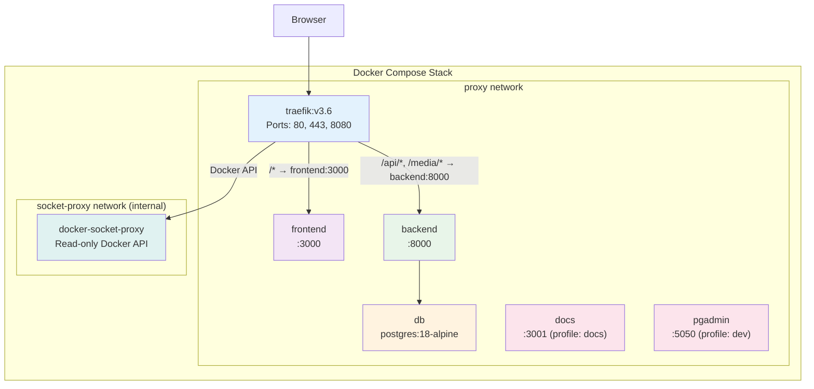
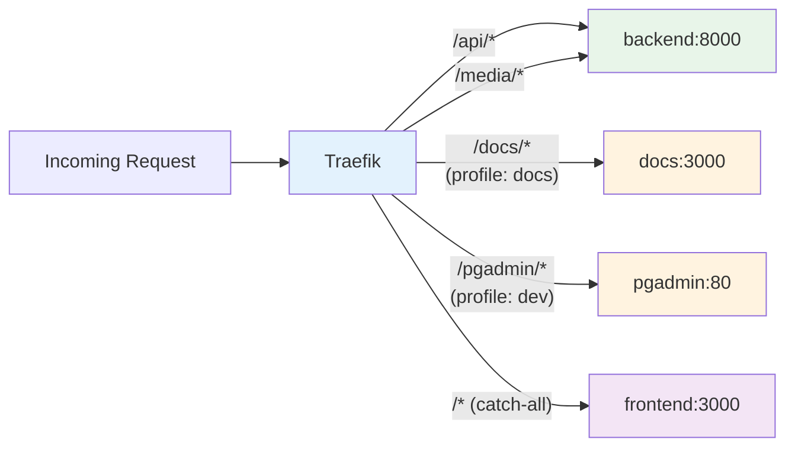
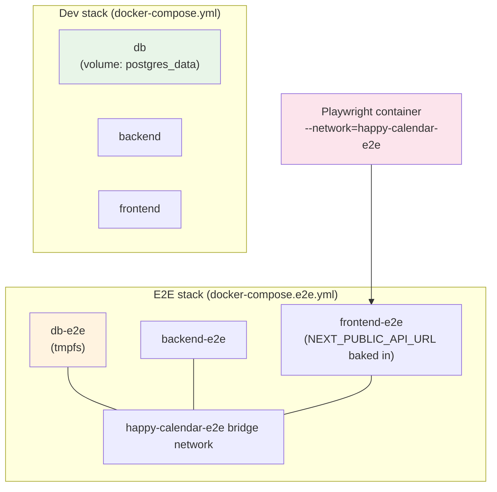

# Deployment

## Overview

Happy Calendar runs as a set of Docker containers orchestrated by Docker Compose, with Traefik as the reverse proxy handling routing, TLS termination, and HTTP-to-HTTPS redirection. The stack consists of a PostgreSQL database, a Django backend, a Next.js frontend, and optional documentation and pgAdmin services.

## Prerequisites

- **Docker** version 20.10+
- **Docker Compose** version 2.0+
- **Make** (for the Makefile commands)
- **Operating System**: Linux, macOS, or Windows with WSL2
- Ports **80**, **443**, and **8080** available on the host

## Quick Start

```bash
# Clone the repository
git clone <repository-url>
cd happy-calendar

# First-time setup: build, start, migrate, and create admin user
make init
```

That's it. `make init` runs the full initialization sequence — building images, starting containers, running database migrations, and creating the default admin user.

## Access URLs (Local Development)

| Service | URL | Notes |
|---|---|---|
| **Frontend** | `https://localhost` | Via Traefik (self-signed TLS) |
| **Backend API** | `https://localhost/api/` | Via Traefik |
| **Swagger UI** | `https://localhost/api/docs/` | Interactive API docs |
| **ReDoc** | `https://localhost/api/redoc/` | Alternative API docs |
| **Traefik Dashboard** | `http://localhost:8080` | Traefik admin UI |
| **Documentation** (via Traefik) | `https://${DOMAIN}/docs/` | Requires `--profile docs` |
| **Documentation** (direct) | `http://localhost:3001/docs/` | Same container, bypasses Traefik |
| **pgAdmin** (via Traefik) | `https://${DOMAIN}/pgadmin/` | Requires `--profile dev` |
| **pgAdmin** (direct) | `http://localhost:5050/pgadmin/` | Same container, bypasses Traefik |

> **Note:** Local development uses a self-signed TLS certificate. Your browser will show a security warning — this is expected. Accept the certificate to proceed.

## Docker Architecture



## Services

### `db` — PostgreSQL Database

- **Image**: `postgres:18-alpine`
- **Environment**: `POSTGRES_DB=nursery`, `POSTGRES_USER=nursery`, `POSTGRES_PASSWORD=nursery`
- **Volume**: `postgres_data` mounted to `/var/lib/postgresql`
- **Healthcheck**: `pg_isready` command to verify the database is accepting connections
- **Network**: `proxy`

### `backend` — Django API Server

- **Build context**: `./backend`
- **Environment variables**: `DEBUG`, `DJANGO_SECRET_KEY`, `POSTGRES_DB`, `POSTGRES_USER`, `POSTGRES_PASSWORD`, `POSTGRES_HOST`, `POSTGRES_PORT`
- **Volume**: `./backend:/app` (live code reload in development)
- **Depends on**: `traefik`, `db` (with `condition: service_healthy`)
- **Command**: Runs migrations then starts the Django development server
- **Traefik labels**: Routes `/api/*` and `/media/*` to `backend:8000`

### `frontend` — Next.js Application

- **Build context**: `./frontend` (`node:24-alpine` base)
- **Environment**: `NEXT_PUBLIC_API_URL`
- **Depends on**: `traefik`, `backend`
- **Traefik labels**: Routes `/*` (catch-all) to `frontend:3000`

### `notification-cron` — Daily Notification Scheduler

- **Build context**: `./backend` (shares the backend image)
- **Purpose**: Polls `NotificationCron.run_time` once per minute and fires `python manage.py generate_notifications` when the wall clock matches. Required for the staff inbox / email reminders.
- **Environment**: same Postgres + email + secret-key vars as `backend`.
- **Always on**: not behind a Compose profile. If the `notifications` feature flag is off, the cron's tick is a no-op (so disabling the feature doesn't require taking the service down).

### `garage` — S3-Compatible Object Storage (optional)

- **Image**: `dxflrs/garage:v1.0.1`
- **Profile**: `s3` — only starts with `--profile s3 up -d`
- **Purpose**: Single-node S3-compatible storage backend for the bundled-self-hosted deployment path. The backend talks to it over the `proxy` network at `http://garage:3900`.
- **Bootstrap**: `make s3-init` runs the one-shot `layout assign` + bucket-create + key-import steps; the script is idempotent and safe to re-run. See [File Storage](#file-storage) below.
- **Volumes**: `garage_meta` and `garage_data` for the metadata DB and the bucket payload.
- **Healthcheck**: Garage's image is distroless (no `wget`/`curl`); the healthcheck calls `/garage status` and gives 30s as `start_period`.

### `docs` — Documentation Site (optional)

- **Build context**: `./docs` (Docusaurus 3.10+, `node:24-alpine`)
- **Port**: `3001:3000` (direct access; reaches the same content as the Traefik route)
- **Profile**: `docs` — only starts with `--profile docs`
- **Build-time env**: `DOCS_BASE_URL=/docs/` is passed in so Docusaurus emits absolute asset URLs prefixed with `/docs/`. This matches the Traefik PathPrefix below; no `StripPrefix` middleware needed.
- **Traefik labels**: `Host(${DOMAIN}) && PathPrefix(/docs)` → `docs:3000`. Active only while the container is up.

### `pgadmin` — Database Admin UI (optional)

- **Image**: `dpage/pgadmin4`
- **Port**: `5050:80` (direct access; reaches the same UI as the Traefik route)
- **Profile**: `dev` — only starts with `--profile dev`
- **Env**: `SCRIPT_NAME=/pgadmin` tells pgAdmin its URL prefix so every emitted URL (login redirect, asset paths, AJAX endpoints) carries `/pgadmin/`. Defaults `PGADMIN_DEFAULT_EMAIL=admin@admin.com` / `PGADMIN_DEFAULT_PASSWORD=admin`.
- **Traefik labels**: `Host(${DOMAIN}) && PathPrefix(/pgadmin)` → `pgadmin:80`. Active only while the container is up.

### `docker-socket-proxy` — Secure Docker API Access

- **Image**: `tecnativa/docker-socket-proxy`
- **Purpose**: Provides read-only Docker API access to Traefik, avoiding the need to mount the Docker socket directly into the Traefik container (security best practice).
- **Network**: `socket-proxy` (internal)

### `traefik` — Reverse Proxy & TLS

- **Image**: `traefik:v3.6`
- **Ports**: `8080` (dashboard), `80` (HTTP), `443` (HTTPS)
- **Features**:
  - HTTP → HTTPS redirection
  - Self-signed TLS certificate as fallback for local development
  - Let's Encrypt support via Cloudflare DNS challenge for production (configured via `CF_DNS_API_TOKEN` and `ACME_EMAIL` environment variables)
- **Networks**: `proxy`, `socket-proxy`

## Networks

| Network | Type | Purpose |
|---|---|---|
| `proxy` | bridge | Main network connecting all application services and Traefik |
| `socket-proxy` | internal, bridge | Isolated network for secure Docker socket access between Traefik and docker-socket-proxy |

## Volumes

| Volume | Purpose |
|---|---|
| `postgres_data` | Persistent PostgreSQL data |
| `traefik-certs` | TLS certificates (Let's Encrypt and self-signed) |

## Environment Variables

Generate `.env` once with `make env` (interactive, idempotent, never overwrites). Every variable below has a `${VAR:-default}` interpolation in `docker-compose.yml`, so a fresh checkout boots with no `.env` at all — production deployments override the relevant vars in their own `.env`.

### Backend / Database

| Variable | Description | Default | Production override |
|---|---|---|---|
| `DEBUG` | Django debug mode. Settings **fail closed**: when `DEBUG=False` a missing `DJANGO_SECRET_KEY` aborts startup. | `False` (env-absent); the dev compose sets `True` | **Required** — keep `False` |
| `DJANGO_SECRET_KEY` | Django secret key. No production fallback — required when `DEBUG=False`. | dev placeholder (only used when `DEBUG=True`) | **Required** — generate via `python -c 'import secrets; print(secrets.token_urlsafe(50))'` |
| `ALLOWED_HOSTS` | Comma-separated hostnames Django serves. `*` added automatically only when `DEBUG=True`. | `localhost,127.0.0.1` | **Required** — set the public hostname(s) |
| `CORS_ALLOWED_ORIGINS` | Comma-separated origins allowed cross-origin when `DEBUG=False` (all origins allowed in dev). | empty | Set the frontend origin(s), or leave empty when served same-origin |
| `POSTGRES_DB` | Database name | `nursery` | Optional |
| `POSTGRES_USER` | Database user | `nursery` | Optional |
| `POSTGRES_PASSWORD` | Database password | `nursery` | **Required** — committed default is public |
| `POSTGRES_HOST` | Database host | `db` | Override only when pointing at an external Postgres |
| `POSTGRES_PORT` | Database port | `5432` | Optional |

The REST API defaults to `IsAuthenticated` (default-deny): any endpoint that forgets to declare permissions is closed to anonymous callers. Only login, register, token refresh, translations, and the public nursery-settings/logo read opt into `AllowAny`.

### Frontend

| Variable | Description | Default |
|---|---|---|
| `NEXT_PUBLIC_API_URL` | Backend API base URL the browser uses | Set via Docker Compose |

### Email (notifications)

| Variable | Description | Default |
|---|---|---|
| `EMAIL_BACKEND` | Django mail backend | `django.core.mail.backends.console.EmailBackend` (logs to stdout) |
| `EMAIL_HOST` | SMTP host | `localhost` |
| `EMAIL_PORT` | SMTP port (`587` STARTTLS, `465` SMTPS, `25` plaintext) | `25` |
| `EMAIL_HOST_USER` | SMTP auth username | empty |
| `EMAIL_HOST_PASSWORD` | SMTP auth password | empty |
| `EMAIL_USE_TLS` | Issue STARTTLS on connect | `False` |
| `DEFAULT_FROM_EMAIL` | From address for outgoing mail | `happy-calendar@localhost` |

When `EMAIL_BACKEND` stays on the console backend in production AND the `notifications` flag is on, the cron emits a one-shot startup warning so silent stdout-only delivery isn't invisible.

### Object storage (the `s3` profile)

Opt in to S3-compatible storage for uploaded files. When all four required vars are set + non-empty, the backend switches off filesystem mode at startup. Half-applied configs fall back to filesystem with a warning naming the missing var.

| Variable | Description | Required |
|---|---|---|
| `S3_ENDPOINT_URL` | URL the BACKEND uses to reach the bucket. For bundled Garage: `http://garage:3900`. For AWS: `https://s3.<region>.amazonaws.com`. | Yes |
| `S3_PUBLIC_ENDPOINT_URL` | URL baked into client-facing `.url()` responses. Set when Garage is exposed via a Traefik subdomain different from the internal one. Falls back to `S3_ENDPOINT_URL` when unset. | No |
| `S3_ACCESS_KEY_ID` | Access key. For bundled Garage: `GK[a-f0-9]{24}` (26 chars). AWS / MinIO accept any base64. | Yes |
| `S3_SECRET_ACCESS_KEY` | Secret key. For bundled Garage: `[a-f0-9]{64}`. AWS / MinIO accept any base64. | Yes |
| `S3_BUCKET_NAME` | Target bucket. `make s3-init` creates it on the bundled Garage when missing. | Yes |
| `S3_REGION_NAME` | Region label. Default suits Garage; AWS requires a real region (`us-east-1`). | No (defaults `garage`) |
| `S3_ADDRESSING_STYLE` | `path` for Garage / MinIO / local dev; `virtual` for AWS S3. | No (defaults `path`) |
| `S3_QUERYSTRING_AUTH` | When `True`, `.url()` returns time-limited presigned URLs. Defaults `False` (matches the historical "uploads are public" behaviour). | No |
| `S3_TRAEFIK_ENABLED` | When `true`, enables a Traefik route that exposes Garage at `https://s3.${DOMAIN}`. Off by default; backend ↔ Garage stays inside the Docker network. | No |

Garage internal secrets (only used by the bundled Garage instance, NOT by the Django backend):

| Variable | Description |
|---|---|
| `GARAGE_RPC_SECRET` | RPC secret (must be 64 hex chars). Dev default committed in compose; **production must override**. |
| `GARAGE_ADMIN_TOKEN` | Bearer token for the Garage admin API. Dev default committed; production must override. |
| `GARAGE_METRICS_TOKEN` | Bearer token for Prometheus metrics. Dev default committed; production must override. |

### Docker Compose / Traefik

| Variable | Description | Usage |
|---|---|---|
| `DOMAIN` | Public hostname (Traefik `Host()` rule) | Traefik routing rules |
| `NEXT_PUBLIC_API_URL` | API URL passed to frontend | Frontend build |
| `CF_DNS_API_TOKEN` | Cloudflare DNS API token | Let's Encrypt DNS-01 challenge |
| `ACME_EMAIL` | Email for Let's Encrypt | Certificate registration |
| `DOCKER_SOCKET` | Path to Docker socket | docker-socket-proxy mount |

The full per-variable guidance lives as comments in `.env.example` itself; `make env` reads those comments and shows them at each prompt.

## Routing

Traefik handles all incoming HTTP/HTTPS traffic and routes based on path-prefix specificity (Traefik picks the longest-matching `PathPrefix` as the most specific, so longer prefixes always win over the catch-all):



- `/api/*` and `/media/*` → Django backend
- `/docs/*` → Docusaurus docs container (only when the `docs` profile is up; baked-in `baseUrl=/docs/`)
- `/pgadmin/*` → pgAdmin container (only when the `dev` profile is up; `SCRIPT_NAME=/pgadmin`)
- everything else → Next.js frontend (catch-all, lowest priority)
- HTTP on port 80 redirects to HTTPS on 443 globally

## Makefile Commands

The project includes a comprehensive Makefile in the repository root for common operations.

### Setup & Lifecycle

| Command | Description |
|---|---|
| `make env` | Interactive `.env` bootstrap from `.env.example`. Idempotent; never overwrites. |
| `make init` | First-time setup: `env-check` → `volume-ensure` → `build` → `up` → `migrate` → `create-admin` |
| `make build` | Build all Docker images |
| `make up` / `make down` | Start / stop all services |
| `make restart` | Restart all services |
| `make rebuild` | Rebuild and restart all services |
| `make clean` | Stop services and remove containers (the `postgres_data` volume is preserved) |
| `make status` | Show status of all containers |
| `make seed-example-data` | Populate a deterministic demo dataset (idempotent). `SEED_ARGS=--reset` wipes the seeded rows first; `SEED_ARGS=--allow-production` bypasses the `DEBUG=False` guard. |

### Logs

| Command | Description |
|---|---|
| `make logs` | Follow logs for all services |
| `make logs-backend` | Follow backend logs only |
| `make logs-frontend` | Follow frontend logs only |
| `make logs-db` | Follow database logs only |

### Shell Access

| Command | Description |
|---|---|
| `make shell-backend` | Open a shell in the backend container |
| `make shell-frontend` | Open a shell in the frontend container |
| `make shell-db` | Open a psql shell in the database container |

### Database

| Command | Description |
|---|---|
| `make migrate` | Run Django database migrations |
| `make makemigrations` | Generate new migration files |
| `make createsuperuser` | Create a Django superuser interactively |
| `make create-admin` | Create the default admin user |
| `make backup` | Full gzipped `pg_dump` → `backups/nursery-<YYYY-MM-DD-HHMMSS>.sql.gz` |
| `make restore` | Restore the DB from the latest backup (or `BACKUP_FILE=path make restore`). Destructive; requires typed `yes` (or `RESTORE_I_UNDERSTAND=yes` in CI). |
| `make destroy-db` | Irreversibly remove the `happy-calendar_postgres_data` volume. The only path that does so. Requires typed confirmation. |
| `make upgrade` | `backup → git pull → build → up → migrate`. `SKIP_BACKUP=1` to skip step 1; `SKIP_PULL=1` to skip step 2. |

### Testing

| Command | Description |
|---|---|
| `make test` | Run all tests (`test-backend` + `test-frontend`) |
| `make test-backend` | Run backend tests only (Django runner + SQLite in-memory). 539 tests in ~2.5 s. |
| `make test-frontend` | Run frontend Playwright E2E tests against an isolated `db-e2e` + `backend-e2e` + `frontend-e2e` stack (`docker-compose.e2e.yml`). 163 tests in ~60 s. `KEEP_E2E_DATA=1` keeps the e2e stack up after the run for inspection. |
| `make test-frontend-debug` | Same as above with `PLAYWRIGHT_ARGS=--trace=on` |
| `make test-coverage` | Backend tests with coverage reporting |
| `make e2e-up` / `make e2e-down` | Manually drive the isolated e2e stack. Rarely needed — `make test-frontend` handles the lifecycle. |

### Code Quality & Security

| Command | Description |
|---|---|
| `make lint` | Run `flake8` on the backend |
| `make format` | Auto-format all code |
| `make security` | OWASP-Top-10 suite: bandit + pip-audit + npm audit + Django `check --deploy` + gitleaks + opt-in OWASP ZAP baseline. Lands `security-reports/<timestamp>/REPORT.md`; `security-reports/latest/REPORT.md` symlinks the most recent. Exits non-zero on `critical` findings. Override retention via `SECURITY_REPORT_KEEP` (default 10). |
| `make ci` | Run the full CI gate locally: `lint` → `test` → `security`. Fails on the first failing stage. |

### Continuous Integration

`make ci` is the canonical quality gate — it runs `make lint`, `make test`
(backend + frontend), and `make security` in sequence, each inside the pinned
container images. Because everything runs in Docker, a green `make ci` on a
laptop predicts a green run anywhere.

The target is deliberately **provider-agnostic**: whatever CI system is wired
up (GitHub Actions, GitLab CI, a Jenkins job, or a server-side `post-receive`
hook) only needs a Docker-capable runner that checks out the code and runs
`make ci`. The `security` stage exits non-zero on any `critical` finding, so it
is suitable as a required merge gate; `security-reports/latest/REPORT.md` is
produced for a job to publish as an artefact.

### S3 / Object storage

| Command | Description |
|---|---|
| `make s3-init` | Bootstrap the bundled Garage instance: layout assign + bucket create + access-key import. Idempotent; safe to re-run. Requires the `s3` profile to be up. |

## Database Management

### Migrations

Migrations run automatically as part of the backend container startup command. To run them manually:

```bash
make migrate              # Apply pending migrations
make makemigrations       # Generate new migration files
```

### Backup & Restore

```bash
# Backup the database
docker compose exec db pg_dump -U nursery nursery > backup.sql

# Restore from backup
docker compose exec -T db psql -U nursery nursery < backup.sql
```

### Reset Database

```bash
# Stop everything and remove volumes (destroys all data)
make clean

# Rebuild from scratch
make init
```

## File Storage

The backend's storage backend is environment-driven (see [Architecture → File Storage](architecture.md#file-storage) for the diagram). Three modes:

### Mode 1 — Filesystem (default)

Uploads land under `backend/media/`. Zero configuration. Backed up via rsync.

### Mode 2 — External S3-compatible service

Set the four required `S3_*` env vars in `.env`. The backend switches to `django-storages[s3]` at startup. Works against AWS S3, MinIO, Backblaze B2, or any S3-compatible service.

```env
S3_ENDPOINT_URL=https://s3.us-east-1.amazonaws.com
S3_ACCESS_KEY_ID=AKIA...
S3_SECRET_ACCESS_KEY=...
S3_BUCKET_NAME=happy-calendar-media
S3_REGION_NAME=us-east-1
S3_ADDRESSING_STYLE=virtual    # AWS only; use `path` for everything else
```

Restart the backend (`make restart`) and verify with the startup log: it should announce `STORAGES['default'] = S3Boto3Storage(...)`. If the backend logs a warning about a missing var, the config is half-applied — uploads are silently going to filesystem.

### Mode 3 — Bundled Garage (`s3` Compose profile)

For self-hosted single-host deployments, the repo ships a `garage` service under the `s3` Compose profile. Bring it up and bootstrap with:

```bash
# 1. Pick an S3_BUCKET_NAME, S3_ACCESS_KEY_ID (matching GK[a-f0-9]{24}),
#    and S3_SECRET_ACCESS_KEY (matching [a-f0-9]{64}) and write them to .env.
#    GARAGE_RPC_SECRET / GARAGE_ADMIN_TOKEN / GARAGE_METRICS_TOKEN have
#    committed dev defaults, so dev environments don't need to set them;
#    production deployments MUST override per the comments in .env.example.

# 2. Bring up Garage:
docker compose --profile s3 up -d garage

# 3. Bootstrap bucket + key (idempotent — safe to re-run):
make s3-init

# 4. Restart the backend so it picks up the new env:
make restart
```

The script does the one-shot Garage 1.0 `layout assign` + `apply` step before bucket/key operations. Re-running is a no-op once the layout exists.

To expose Garage at `https://s3.${DOMAIN}` (e.g. so the backend's `.url()` responses point at a public S3 URL instead of the Docker network address), set `S3_TRAEFIK_ENABLED=true` and `S3_PUBLIC_ENDPOINT_URL=https://s3.${DOMAIN}` in `.env` and restart.

## Security Testing

`make security` runs an OWASP-Top-10-style suite that combines static analysis, dependency CVE auditing, deployment-config checks, secret scanning, and an opt-in DAST run:

```bash
make security                      # Full suite (default)
SECURITY_ZAP=1 make security       # Add the OWASP ZAP baseline pass
SECURITY_REPORT_KEEP=20 make security  # Keep the last 20 reports (default 10)
```

What it runs:

| Tool | Scope |
|---|---|
| `bandit` | Python static analysis on `backend/` (SQL injection patterns, weak crypto, hardcoded secrets, `shell=True`, pickle on untrusted data) |
| `pip-audit` | Python dep CVEs against the runtime + dev requirements |
| `npm audit` | Node dep CVEs against `frontend/package-lock.json` and `docs/package-lock.json` |
| Django `check --deploy` | Production-readiness flags (DEBUG, SECRET_KEY length, CORS, SECURE_* headers, …) |
| `gitleaks` | Whole-tree secret scan (current working tree + recent git history). The repo ships a `.gitleaks.toml` with project-specific allowlists for the dev defaults committed into `docker-compose.yml`. |
| Custom Django tests | OWASP-aligned cases: CSRF, reflected XSS, SSRF in upload paths, IDOR on per-entity history endpoints, etc. |
| OWASP ZAP baseline (opt-in) | Spider + passive scan of the running backend. Off by default because it spins up a separate ZAP container. |

Each run lands a `security-reports/<timestamp>/REPORT.md` plus per-tool sub-reports; `security-reports/latest/REPORT.md` symlinks the newest. The make target exits non-zero on any `critical` finding so it can gate CI.

## E2E Test Isolation

Playwright tests never touch the dev database. They run against a fully separate Compose stack defined in `docker-compose.e2e.yml`:



- **Own Compose project** (`happy-calendar-e2e`) and bridge network — running e2e never touches the dev compose project.
- **`db-e2e`** uses `tmpfs` for its data directory, so the database is fully ephemeral. Stopping the container wipes every byte.
- **`backend-e2e`** runs migrations on every cold boot.
- **`frontend-e2e`** is built with `NEXT_PUBLIC_API_URL=http://backend-e2e:8000/api` baked into the Next.js bundle so browser-side API calls resolve correctly without `page.route` mocking.
- **Lifecycle**: `make test-frontend` brings the e2e stack up, runs Playwright against it, and tears it down on exit. Set `KEEP_E2E_DATA=1` to leave the stack running for inspection — `make e2e-down` cleans up later.
- **Live spec**: `openspec/specs/tooling/e2e-isolation/spec.md`.

## Production Deployment

### TLS with Let's Encrypt

For production, configure automatic TLS certificates via Cloudflare DNS challenge:

1. Set the required environment variables:
   ```bash
   export DOMAIN=yourdomain.com
   export ACME_EMAIL=admin@yourdomain.com
   export CF_DNS_API_TOKEN=your-cloudflare-api-token
   ```

2. Traefik will automatically obtain and renew certificates from Let's Encrypt using the Cloudflare DNS challenge. Certificates are stored in the `traefik-certs` volume.

3. If no Cloudflare token is configured, Traefik falls back to a self-signed certificate.

### Security Considerations

- **Django secret key**: Always set a unique `DJANGO_SECRET_KEY` in production. Never use the default development key.
- **Database password**: Change `POSTGRES_PASSWORD` from the default `nursery` value.
- **Debug mode**: Ensure `DEBUG=False` in production.
- **Docker socket**: The `docker-socket-proxy` provides read-only API access to Traefik, avoiding direct Docker socket mounting.

## Optional Services

### Documentation Site

Start the documentation site alongside the main stack:

```bash
docker compose --profile docs up -d
```

Access via Traefik at `https://${DOMAIN}/docs/` (TLS-terminated, behind the same domain as the app), or directly at `http://localhost:3001/docs/`.

The site is served behind a sub-path because Docusaurus needs `baseUrl` set at BUILD time. The compose file passes `DOCS_BASE_URL=/docs/` to the build, and `docs/docusaurus.config.js` reads it via `process.env.DOCS_BASE_URL`. This means absolute asset URLs (e.g. `<link href="/docs/assets/css/styles.css">`) match what Traefik routes — no `StripPrefix` middleware needed. The cost is that direct port-forward access has the same prefix (`http://localhost:3001/docs/`, not `http://localhost:3001/`).

### pgAdmin

Start pgAdmin for database administration:

```bash
docker compose --profile dev up -d
```

Access via Traefik at `https://${DOMAIN}/pgadmin/`, or directly at `http://localhost:5050/pgadmin/`.

Sub-path serving works because the compose file sets `SCRIPT_NAME=/pgadmin` on the pgadmin container. pgAdmin reads this and emits every URL (login redirects, asset paths, AJAX endpoints) with the `/pgadmin/` prefix, so the existing PathPrefix routing works without an extra `StripPrefix` middleware. As with docs, direct port access is also at `/pgadmin/`.

Default credentials (override via `PGADMIN_DEFAULT_EMAIL` / `PGADMIN_DEFAULT_PASSWORD` in `docker-compose.yml`):

- **Email:** `admin@admin.com`
- **Password:** `admin`

After login, register a new connection to the `db` host with user `nursery`, password `nursery`, database `nursery` (or whatever you set in `.env`).

## Troubleshooting

### Database Connection Failed

```bash
# Check database health
make status

# View database logs
make logs-db

# Restart database
docker compose restart db
```

### Backend Won't Start

```bash
# Check backend logs for errors
make logs-backend

# Open a shell to debug
make shell-backend

# Re-run migrations manually
make migrate
```

### Frontend Build Issues

```bash
# Check frontend logs
make logs-frontend

# Open a shell to debug
make shell-frontend

# Full rebuild
make rebuild
```

### Port Conflicts

If ports 80, 443, or 8080 are already in use:

```bash
# Find what's using the ports
sudo lsof -i :80
sudo lsof -i :443
sudo lsof -i :8080

# Stop conflicting services before starting the stack
make up
```

### Full Reset

When all else fails, perform a complete reset:

```bash
make clean    # Stop everything and remove volumes
make init     # Rebuild from scratch
```

## Monitoring & Logs

The project relies on Docker's built-in logging. Use the Makefile log commands for day-to-day monitoring:

```bash
make logs            # All services
make logs-backend    # Backend only
make logs-frontend   # Frontend only
make logs-db         # Database only
```

For container resource usage:

```bash
docker stats
```

The Traefik dashboard at `http://localhost:8080` provides real-time information about routing rules, active services, and middleware.
