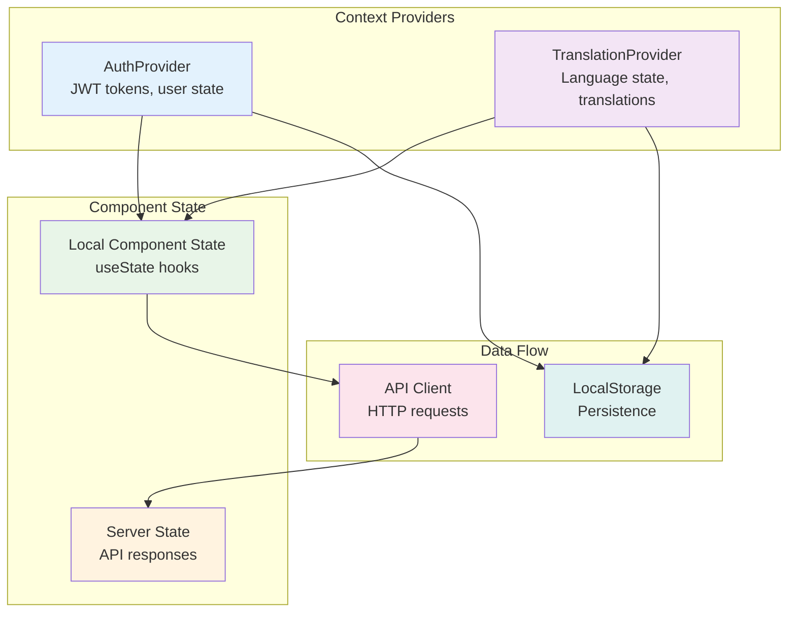

# Frontend Architecture

## Overview

The frontend is a modern React application built with Next.js 16, TypeScript, and TailwindCSS. It provides a responsive, user-friendly interface for managing pet nursery schedules with real-time conflict detection and multi-language support.

## Core Technologies

- **Next.js 16**: React framework with App Router for modern web applications
- **React 19**: Latest React with concurrent features and improved performance
- **TypeScript**: Type-safe JavaScript for better development experience
- **TailwindCSS**: Utility-first CSS framework for responsive design
- **Lucide React**: Modern icon library
- **Date-fns**: Date manipulation library
- **Playwright**: End-to-end testing framework

## Application Structure

The frontend follows Next.js App Router architecture with organized component structure:

```
frontend/
├── src/
│   ├── app/                      # Next.js App Router pages
│   │   ├── page.tsx             # Main calendar page (authenticated)
│   │   ├── login/               # Login page
│   │   ├── register/            # Registration page
│   │   ├── pets/                # Pet management page
│   │   ├── owners/              # Owner management page
│   │   ├── settings/            # Settings & incompatibilities
│   │   ├── layout.tsx           # Root layout with providers
│   │   └── globals.css          # Global styles
│   ├── components/              # Reusable React components
│   │   ├── Calendar.tsx         # Monthly calendar view
│   │   ├── WeekView.tsx         # Weekly schedule view
│   │   ├── DaySchedule.tsx      # Daily schedule panel
│   │   ├── ScheduleForm.tsx     # Single pet scheduling
│   │   ├── MultiPetScheduleForm.tsx # Batch scheduling
│   │   ├── PetForm.tsx          # Pet CRUD form
│   │   ├── PetList.tsx          # Pet listing component
│   │   ├── OwnerForm.tsx        # Owner CRUD form
│   │   ├── OwnerList.tsx        # Owner listing component
│   │   ├── Navigation.tsx       # Main navigation component
│   │   ├── LanguageSwitcher.tsx # i18n language selector
│   │   └── ThemeToggle.tsx      # Dark mode toggle
│   └── lib/                     # Utilities and services
│       ├── api.ts               # API client and types
│       ├── translations.tsx     # i18n context and hooks
│       └── auth.tsx             # Authentication context
├── public/                      # Static assets
├── package.json                 # Dependencies and scripts
├── tailwind.config.ts           # TailwindCSS configuration
├── next.config.ts               # Next.js configuration
└── Dockerfile                   # Container configuration
```

## Component Architecture

### State Management

The application uses React Context for global state management:



### Authentication Context

```typescript
interface AuthContextType {
  isAuthenticated: boolean;
  isAdmin: boolean;
  user: User | null;
  isLoading: boolean;
  login: (username: string, password: string) => Promise<void>;
  logout: () => Promise<void>;
  register: (userData: RegisterData) => Promise<void>;
  refreshToken: () => Promise<void>;
}

const AuthProvider: React.FC<{ children: React.ReactNode }> = ({ children }) => {
  const [isAuthenticated, setIsAuthenticated] = useState(false);
  const [isAdmin, setIsAdmin] = useState(false);
  const [user, setUser] = useState<User | null>(null);
  const [isLoading, setIsLoading] = useState(true);

  // JWT token management
  const [accessToken, setAccessToken] = useState<string | null>(null);
  const [refreshTokenValue, setRefreshToken] = useState<string | null>(null);

  // Initialize auth state from localStorage
  useEffect(() => {
    const initAuth = async () => {
      const storedAccess = localStorage.getItem('access_token');
      const storedRefresh = localStorage.getItem('refresh_token');

      if (storedAccess && storedRefresh) {
        setAccessToken(storedAccess);
        setRefreshToken(storedRefresh);

        try {
          // Validate token and get user info
          const userData = await getCurrentUser();
          setUser(userData);
          setIsAuthenticated(true);
          setIsAdmin(userData.role === 'admin');
        } catch (error) {
          // Token invalid, clear storage
          logout();
        }
      }

      setIsLoading(false);
    };

    initAuth();
  }, []);

  // Auto-refresh token before expiration
  useEffect(() => {
    if (accessToken) {
      const tokenPayload = JSON.parse(atob(accessToken.split('.')[1]));
      const expiresAt = tokenPayload.exp * 1000;
      const refreshAt = expiresAt - 5 * 60 * 1000; // 5 minutes before expiry

      const timeout = setTimeout(async () => {
        try {
          await refreshToken();
        } catch (error) {
          logout();
        }
      }, refreshAt - Date.now());

      return () => clearTimeout(timeout);
    }
  }, [accessToken]);

  const login = async (username: string, password: string) => {
    const response = await api.post('/auth/login/', { username, password });

    const { access, refresh, user: userData } = response.data;

    setAccessToken(access);
    setRefreshToken(refresh);
    setUser(userData);
    setIsAuthenticated(true);
    setIsAdmin(userData.role === 'admin');

    localStorage.setItem('access_token', access);
    localStorage.setItem('refresh_token', refresh);
  };

  const logout = async () => {
    if (refreshTokenValue) {
      try {
        await api.post('/auth/logout/', { refresh: refreshTokenValue });
      } catch (error) {
        // Ignore logout errors
      }
    }

    setAccessToken(null);
    setRefreshToken(null);
    setUser(null);
    setIsAuthenticated(false);
    setIsAdmin(false);

    localStorage.removeItem('access_token');
    localStorage.removeItem('refresh_token');
  };

  const register = async (userData: RegisterData) => {
    await api.post('/auth/register/', userData);
    await login(userData.username, userData.password);
  };

  const refreshToken = async () => {
    const response = await api.post('/auth/refresh/', {
      refresh: refreshTokenValue
    });

    const { access } = response.data;
    setAccessToken(access);
    localStorage.setItem('access_token', access);
  };

  const value: AuthContextType = {
    isAuthenticated,
    isAdmin,
    user,
    isLoading,
    login,
    logout,
    register,
    refreshToken,
  };

  return (
    <AuthContext.Provider value={value}>
      {children}
    </AuthContext.Provider>
  );
};
```

### Translation System

```typescript
interface TranslationContextType {
  t: (key: string, params?: Record<string, any>) => string;
  language: string;
  setLanguage: (lang: string) => void;
  translations: Record<string, any>;
}

const TranslationProvider: React.FC<{ children: React.ReactNode }> = ({ children }) => {
  const [language, setLanguageState] = useState('en');
  const [translations, setTranslations] = useState<Record<string, any>>({});

  // Load translations for current language
  useEffect(() => {
    const loadTranslations = async () => {
      try {
        const response = await fetch(`/api/translations/${language}/`);
        const data = await response.json();
        setTranslations(data);
      } catch (error) {
        console.error('Failed to load translations:', error);
        // Fallback to English
        if (language !== 'en') {
          const fallbackResponse = await fetch('/api/translations/en/');
          const fallbackData = await fallbackResponse.json();
          setTranslations(fallbackData);
        }
      }
    };

    loadTranslations();
  }, [language]);

  // Load language from localStorage on mount
  useEffect(() => {
    const storedLanguage = localStorage.getItem('language') || 'en';
    setLanguageState(storedLanguage);
  }, []);

  // Persist language changes
  const setLanguage = (lang: string) => {
    setLanguageState(lang);
    localStorage.setItem('language', lang);
  };

  // Translation function with interpolation
  const t = (key: string, params?: Record<string, any>): string => {
    const keys = key.split('.');
    let value = translations;

    for (const k of keys) {
      value = value?.[k];
    }

    if (typeof value !== 'string') {
      return key; // Return key if translation not found
    }

    // Simple interpolation
    if (params) {
      return Object.entries(params).reduce(
        (str, [paramKey, paramValue]) =>
          str.replace(new RegExp(`\\{${paramKey}\\}`, 'g'), String(paramValue)),
        value
      );
    }

    return value;
  };

  const value: TranslationContextType = {
    t,
    language,
    setLanguage,
    translations,
  };

  return (
    <TranslationContext.Provider value={value}>
      {children}
    </TranslationContext.Provider>
  );
};
```

## API Client

The API client handles all HTTP communication with the backend:

```typescript
class ApiClient {
  private baseURL: string;
  private accessToken: string | null = null;

  constructor(baseURL: string = '/api') {
    this.baseURL = baseURL;
  }

  setAccessToken(token: string | null) {
    this.accessToken = token;
  }

  private async request<T>(
    endpoint: string,
    options: RequestInit = {}
  ): Promise<T> {
    const url = `${this.baseURL}${endpoint}`;

    const headers: HeadersInit = {
      'Content-Type': 'application/json',
      ...options.headers,
    };

    if (this.accessToken) {
      headers.Authorization = `Bearer ${this.accessToken}`;
    }

    const response = await fetch(url, {
      ...options,
      headers,
    });

    if (!response.ok) {
      const errorData = await response.json().catch(() => ({}));
      throw new Error(errorData.detail || `HTTP ${response.status}`);
    }

    return response.json();
  }

  async get<T>(endpoint: string): Promise<T> {
    return this.request<T>(endpoint);
  }

  async post<T>(endpoint: string, data: any): Promise<T> {
    return this.request<T>(endpoint, {
      method: 'POST',
      body: JSON.stringify(data),
    });
  }

  async patch<T>(endpoint: string, data: any): Promise<T> {
    return this.request<T>(endpoint, {
      method: 'PATCH',
      body: JSON.stringify(data),
    });
  }

  async delete<T>(endpoint: string): Promise<T> {
    return this.request<T>(endpoint, {
      method: 'DELETE',
    });
  }
}

export const api = new ApiClient();

// Update token when auth context changes
export const useApiClient = () => {
  const { accessToken } = useAuth();

  useEffect(() => {
    api.setAccessToken(accessToken);
  }, [accessToken]);

  return api;
};
```

## Component Patterns

### Calendar Component

The main calendar component handles date selection and schedule visualization:

```typescript
interface CalendarProps {
  selectedDate: Date;
  onDateSelect: (date: Date) => void;
  calendarView: 'month' | 'week';
  onViewChange: (view: 'month' | 'week') => void;
}

const Calendar: React.FC<CalendarProps> = ({
  selectedDate,
  onDateSelect,
  calendarView,
  onViewChange,
}) => {
  const { t } = useTranslation();
  const [schedules, setSchedules] = useState<Schedule[]>([]);
  const [loading, setLoading] = useState(true);

  // Load schedules for current month
  useEffect(() => {
    const loadSchedules = async () => {
      try {
        const startDate = startOfMonth(selectedDate);
        const endDate = endOfMonth(selectedDate);

        const response = await api.get<Schedule[]>('/schedules/', {
          params: {
            start_date: format(startDate, 'yyyy-MM-dd'),
            end_date: format(endDate, 'yyyy-MM-dd'),
          },
        });

        setSchedules(response.data);
      } catch (error) {
        console.error('Failed to load schedules:', error);
      } finally {
        setLoading(false);
      }
    };

    loadSchedules();
  }, [selectedDate]);

  // Group schedules by date
  const schedulesByDate = useMemo(() => {
    const grouped: Record<string, Schedule[]> = {};
    schedules.forEach(schedule => {
      const dateKey = format(new Date(schedule.start_time), 'yyyy-MM-dd');
      if (!grouped[dateKey]) {
        grouped[dateKey] = [];
      }
      grouped[dateKey].push(schedule);
    });
    return grouped;
  }, [schedules]);

  // Render calendar grid
  const renderCalendarDays = () => {
    const monthStart = startOfMonth(selectedDate);
    const monthEnd = endOfMonth(selectedDate);
    const startDate = startOfWeek(monthStart);
    const endDate = endOfWeek(monthEnd);

    const days = [];
    let day = startDate;

    while (day <= endDate) {
      const dateKey = format(day, 'yyyy-MM-dd');
      const daySchedules = schedulesByDate[dateKey] || [];
      const isCurrentMonth = isSameMonth(day, selectedDate);
      const isSelected = isSameDay(day, selectedDate);

      days.push(
        <div
          key={day.toISOString()}
          className={cn(
            'min-h-[100px] p-2 border border-gray-200 dark:border-slate-600 cursor-pointer hover:bg-gray-50 dark:hover:bg-slate-700 transition-colors',
            {
              'bg-blue-50 dark:bg-blue-900/20 border-blue-300 dark:border-blue-600': isSelected,
              'text-gray-400 dark:text-gray-500': !isCurrentMonth,
            }
          )}
          onClick={() => onDateSelect(day)}
        >
          <div className="text-sm font-medium mb-1">
            {format(day, 'd')}
          </div>
          <div className="space-y-1">
            {daySchedules.slice(0, 3).map(schedule => (
              <div
                key={schedule.id}
                className="text-xs p-1 rounded bg-indigo-100 dark:bg-indigo-900/30 text-indigo-800 dark:text-indigo-200 truncate"
              >
                {schedule.pet_name}
              </div>
            ))}
            {daySchedules.length > 3 && (
              <div className="text-xs text-gray-500">
                +{daySchedules.length - 3} more
              </div>
            )}
          </div>
        </div>
      );

      day = addDays(day, 1);
    }

    return days;
  };

  return (
    <div className="bg-white dark:bg-slate-800 rounded-xl shadow-lg p-6">
      <div className="flex items-center justify-between mb-6">
        <h2 className="text-2xl font-bold text-gray-800 dark:text-gray-100">
          {format(selectedDate, 'MMMM yyyy')}
        </h2>
        <div className="flex gap-2">
          <button
            onClick={() => onViewChange('month')}
            className={cn(
              'px-3 py-1 rounded-lg text-sm font-medium transition-colors',
              calendarView === 'month'
                ? 'bg-blue-600 text-white'
                : 'bg-gray-100 dark:bg-slate-700 text-gray-700 dark:text-gray-300'
            )}
          >
            {t('calendar.monthView')}
          </button>
          <button
            onClick={() => onViewChange('week')}
            className={cn(
              'px-3 py-1 rounded-lg text-sm font-medium transition-colors',
              calendarView === 'week'
                ? 'bg-blue-600 text-white'
                : 'bg-gray-100 dark:bg-slate-700 text-gray-700 dark:text-gray-300'
            )}
          >
            {t('calendar.weekView')}
          </button>
        </div>
      </div>

      <div className="grid grid-cols-7 gap-0 border border-gray-200 dark:border-slate-600 rounded-lg overflow-hidden">
        {/* Day headers */}
        {['Sun', 'Mon', 'Tue', 'Wed', 'Thu', 'Fri', 'Sat'].map(day => (
          <div
            key={day}
            className="bg-gray-50 dark:bg-slate-700 p-3 text-center text-sm font-medium text-gray-700 dark:text-gray-300 border-b border-gray-200 dark:border-slate-600"
          >
            {t(`calendar.days.${day.toLowerCase()}`)}
          </div>
        ))}

        {/* Calendar days */}
        {renderCalendarDays()}
      </div>
    </div>
  );
};
```

### Form Components

Forms use controlled components with validation:

```typescript
interface ScheduleFormProps {
  schedule?: Schedule;
  selectedDate: Date;
  onClose: () => void;
  onSave: () => void;
}

const ScheduleForm: React.FC<ScheduleFormProps> = ({
  schedule,
  selectedDate,
  onClose,
  onSave,
}) => {
  const { t } = useTranslation();
  const [formData, setFormData] = useState({
    pet: schedule?.pet || '',
    start_time: schedule?.start_time || format(selectedDate, "yyyy-MM-dd'T'HH:mm"),
    end_time: schedule?.end_time || format(addHours(selectedDate, 1), "yyyy-MM-dd'T'HH:mm"),
    status: schedule?.status || 'scheduled',
  });
  const [pets, setPets] = useState<Pet[]>([]);
  const [loading, setLoading] = useState(false);
  const [errors, setErrors] = useState<Record<string, string[]>>({});

  // Load pets
  useEffect(() => {
    const loadPets = async () => {
      try {
        const response = await api.get<Pet[]>('/pets/');
        setPets(response.data);
      } catch (error) {
        console.error('Failed to load pets:', error);
      }
    };

    loadPets();
  }, []);

  const handleSubmit = async (e: React.FormEvent) => {
    e.preventDefault();
    setLoading(true);
    setErrors({});

    try {
      const data = {
        ...formData,
        pet: parseInt(formData.pet),
      };

      if (schedule) {
        await api.patch(`/schedules/${schedule.id}/`, data);
      } else {
        await api.post('/schedules/', data);
      }

      onSave();
    } catch (error: any) {
      if (error.response?.data) {
        setErrors(error.response.data);
      } else {
        setErrors({ non_field_errors: [error.message] });
      }
    } finally {
      setLoading(false);
    }
  };

  return (
    <div className="fixed inset-0 bg-black bg-opacity-50 flex items-center justify-center p-4 z-50">
      <div className="bg-white dark:bg-slate-800 rounded-xl shadow-xl max-w-md w-full max-h-[90vh] overflow-y-auto">
        <div className="p-6">
          <h3 className="text-xl font-bold text-gray-800 dark:text-gray-100 mb-4">
            {schedule ? t('schedule.editSchedule') : t('schedule.newSchedule')}
          </h3>

          <form onSubmit={handleSubmit} className="space-y-4">
            <div>
              <label className="block text-sm font-medium text-gray-700 dark:text-gray-300 mb-1">
                {t('pet.selectPet')}
              </label>
              <select
                value={formData.pet}
                onChange={(e) => setFormData(prev => ({ ...prev, pet: e.target.value }))}
                className="w-full px-3 py-2 border border-gray-300 dark:border-slate-600 rounded-lg focus:ring-2 focus:ring-blue-500 focus:border-transparent bg-white dark:bg-slate-700 text-gray-900 dark:text-gray-100"
                required
              >
                <option value="">{t('pet.selectPet')}</option>
                {pets.map(pet => (
                  <option key={pet.id} value={pet.id}>
                    {pet.name} ({pet.species})
                  </option>
                ))}
              </select>
              {errors.pet && (
                <p className="mt-1 text-sm text-red-600 dark:text-red-400">
                  {errors.pet[0]}
                </p>
              )}
            </div>

            <div className="grid grid-cols-2 gap-4">
              <div>
                <label className="block text-sm font-medium text-gray-700 dark:text-gray-300 mb-1">
                  {t('schedule.startTime')}
                </label>
                <input
                  type="datetime-local"
                  value={formData.start_time}
                  onChange={(e) => setFormData(prev => ({ ...prev, start_time: e.target.value }))}
                  className="w-full px-3 py-2 border border-gray-300 dark:border-slate-600 rounded-lg focus:ring-2 focus:ring-blue-500 focus:border-transparent bg-white dark:bg-slate-700 text-gray-900 dark:text-gray-100"
                  required
                />
                {errors.start_time && (
                  <p className="mt-1 text-sm text-red-600 dark:text-red-400">
                    {errors.start_time[0]}
                  </p>
                )}
              </div>

              <div>
                <label className="block text-sm font-medium text-gray-700 dark:text-gray-300 mb-1">
                  {t('schedule.endTime')}
                </label>
                <input
                  type="datetime-local"
                  value={formData.end_time}
                  onChange={(e) => setFormData(prev => ({ ...prev, end_time: e.target.value }))}
                  className="w-full px-3 py-2 border border-gray-300 dark:border-slate-600 rounded-lg focus:ring-2 focus:ring-blue-500 focus:border-transparent bg-white dark:bg-slate-700 text-gray-900 dark:text-gray-100"
                  required
                />
                {errors.end_time && (
                  <p className="mt-1 text-sm text-red-600 dark:text-red-400">
                    {errors.end_time[0]}
                  </p>
                )}
              </div>
            </div>

            <div>
              <label className="block text-sm font-medium text-gray-700 dark:text-gray-300 mb-1">
                {t('schedule.status')}
              </label>
              <select
                value={formData.status}
                onChange={(e) => setFormData(prev => ({ ...prev, status: e.target.value }))}
                className="w-full px-3 py-2 border border-gray-300 dark:border-slate-600 rounded-lg focus:ring-2 focus:ring-blue-500 focus:border-transparent bg-white dark:bg-slate-700 text-gray-900 dark:text-gray-100"
              >
                <option value="scheduled">{t('schedule.statuses.scheduled')}</option>
                <option value="checked_in">{t('schedule.statuses.checkedIn')}</option>
                <option value="completed">{t('schedule.statuses.completed')}</option>
                <option value="cancelled">{t('schedule.statuses.cancelled')}</option>
              </select>
            </div>

            {errors.non_field_errors && (
              <div className="bg-red-50 dark:bg-red-900/20 border border-red-200 dark:border-red-800 rounded-lg p-3">
                <ul className="text-sm text-red-600 dark:text-red-400">
                  {errors.non_field_errors.map((error, index) => (
                    <li key={index}>{error}</li>
                  ))}
                </ul>
              </div>
            )}

            <div className="flex gap-3 pt-4">
              <button
                type="button"
                onClick={onClose}
                className="flex-1 px-4 py-2 bg-gray-100 dark:bg-slate-700 hover:bg-gray-200 dark:hover:bg-slate-600 text-gray-700 dark:text-gray-300 rounded-lg transition-colors"
              >
                {t('common.cancel')}
              </button>
              <button
                type="submit"
                disabled={loading}
                className="flex-1 px-4 py-2 bg-blue-600 hover:bg-blue-700 text-white rounded-lg transition-colors disabled:opacity-50 disabled:cursor-not-allowed"
              >
                {loading ? t('common.saving') : t('common.save')}
              </button>
            </div>
          </form>
        </div>
      </div>
    </div>
  );
};
```

## Testing with Playwright

The application includes comprehensive end-to-end tests:

```typescript
// tests/calendar.spec.ts
import { test, expect } from '@playwright/test';

test.describe('Calendar Functionality', () => {
  test.beforeEach(async ({ page }) => {
    // Login before each test
    await page.goto('/login');
    await page.fill('[name="username"]', 'testuser');
    await page.fill('[name="password"]', 'testpass');
    await page.click('button[type="submit"]');
    await page.waitForURL('/');
  });

  test('should display monthly calendar view', async ({ page }) => {
    await expect(page.locator('h2')).toContainText(/^\w+ \d{4}$/);
    await expect(page.locator('.grid.grid-cols-7')).toBeVisible();
  });

  test('should allow date selection', async ({ page }) => {
    const today = new Date();
    const todayString = today.getDate().toString();

    await page.click(`text=${todayString}`);
    await expect(page.locator('.bg-blue-50')).toBeVisible();
  });

  test('should switch to week view', async ({ page }) => {
    await page.click('button:has-text("Week")');
    await expect(page.locator('text="Week View"')).toBeVisible();
  });

  test('should create new schedule', async ({ page }) => {
    await page.click('button:has-text("New Schedule")');
    await expect(page.locator('text="New Schedule"')).toBeVisible();

    await page.selectOption('select[name="pet"]', '1');
    await page.fill('[name="start_time"]', '2024-01-15T10:00');
    await page.fill('[name="end_time"]', '2024-01-15T11:00');
    await page.click('button[type="submit"]');

    await expect(page.locator('text="Schedule created successfully"')).toBeVisible();
  });
});
```

## Responsive Design

The application uses TailwindCSS for responsive design:

```css
/* Mobile-first approach */
.grid {
  display: grid;
}

/* Small screens */
@media (min-width: 640px) {
  .sm\:grid-cols-2 {
    grid-template-columns: repeat(2, minmax(0, 1fr));
  }
}

/* Medium screens */
@media (min-width: 768px) {
  .md\:grid-cols-3 {
    grid-template-columns: repeat(3, minmax(0, 1fr));
  }
}

/* Large screens */
@media (min-width: 1024px) {
  .lg\:grid-cols-4 {
    grid-template-columns: repeat(4, minmax(0, 1fr));
  }
}
```

## Performance Optimizations

### Code Splitting

Next.js automatically code-splits pages, but additional optimization:

```typescript
// Dynamic imports for large components
const ScheduleForm = dynamic(() => import('@/components/ScheduleForm'), {
  loading: () => <div>Loading...</div>,
});

const MultiPetScheduleForm = dynamic(() => import('@/components/MultiPetScheduleForm'), {
  loading: () => <div>Loading...</div>,
});
```

### Image Optimization

Using Next.js Image component for optimized images:

```typescript
import Image from 'next/image';

<Image
  src="/logo.svg"
  alt="Happy Calendar Logo"
  width={40}
  height={40}
  priority
/>
```

### Memoization

Prevent unnecessary re-renders:

```typescript
const DaySchedule = memo(({ date, onEditSchedule, refreshTrigger }: DayScheduleProps) => {
  // Component logic
});
```

## Build and Deployment

### Docker Configuration

```dockerfile
FROM node:20-alpine

WORKDIR /app

COPY package*.json ./
RUN npm ci --only=production

COPY . .

RUN npm run build

EXPOSE 3000

CMD ["npm", "start"]
```

### Environment Variables

```env
NEXT_PUBLIC_API_URL=http://localhost:8000/api
NEXT_PUBLIC_APP_NAME=Happy Calendar
```

## Accessibility

The application follows WCAG guidelines:

- Semantic HTML elements
- ARIA labels for screen readers
- Keyboard navigation support
- High contrast color schemes
- Focus management for modals

## Browser Support

- Chrome 90+
- Firefox 88+
- Safari 14+
- Edge 90+

This frontend architecture provides a robust, scalable, and user-friendly interface for the pet nursery scheduling system.
