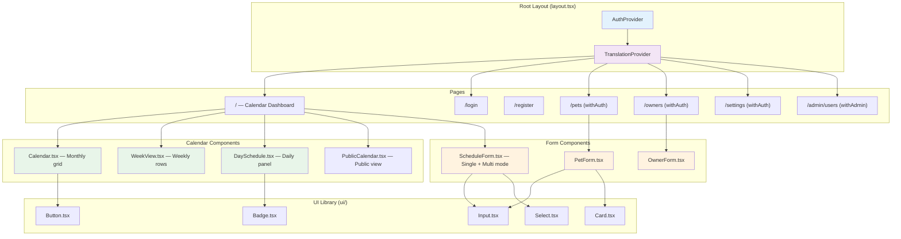
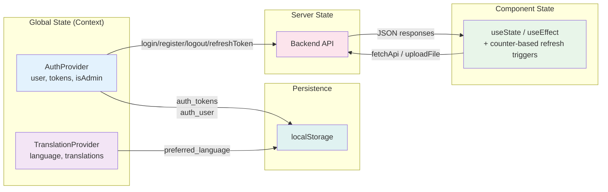
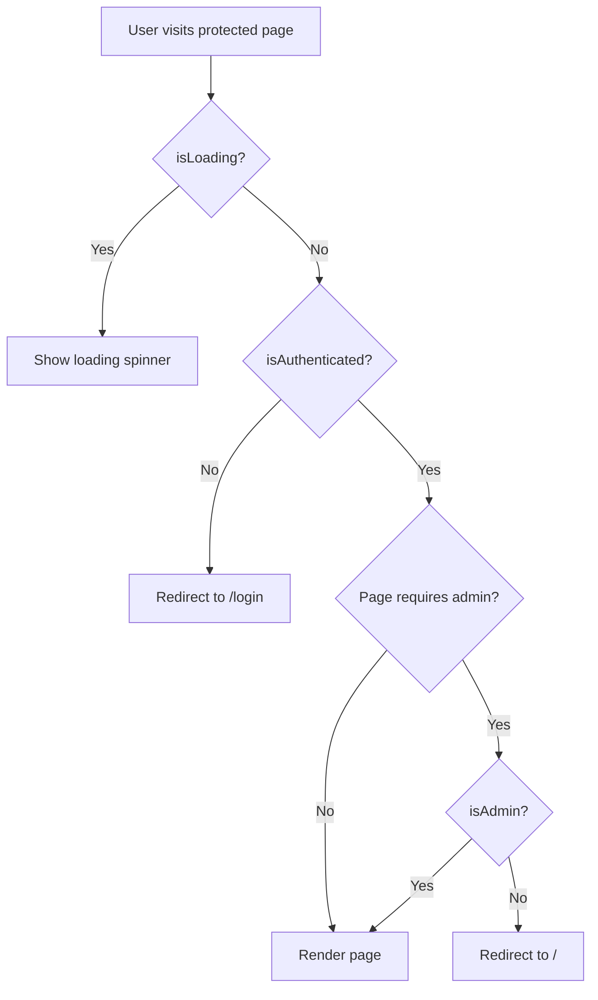

# Frontend Architecture

## Overview

The Happy Calendar frontend is a server-rendered React application built with Next.js 16 and the App Router. It provides a responsive, multi-language interface for managing pet nursery schedules — including monthly/weekly calendar views, real-time conflict detection, pet and owner management, and admin user administration.

## Tech Stack

| Technology | Version | Purpose |
|---|---|---|
| **Next.js** | 16 | Framework (App Router) |
| **React** | 19 | UI library |
| **TypeScript** | 5.7 | Type safety |
| **TailwindCSS** | 3.4 | Utility-first styling |
| **Lucide React** | — | Icon library |
| **date-fns** | — | Date manipulation |
| **Playwright** | — | End-to-end testing |

> **No external state management libraries are used** — no Redux, Zustand, Jotai, or similar. All global state is managed through React Context + hooks. Local component state uses `useState` and `useEffect`.

## Directory Structure

```
frontend/
├── src/
│   ├── app/                        # Next.js App Router pages
│   │   ├── layout.tsx              # Root layout: AuthProvider + TranslationProvider
│   │   ├── page.tsx                # Main calendar page (public + authenticated views)
│   │   ├── login/page.tsx          # Login page
│   │   ├── register/page.tsx       # Registration page
│   │   ├── pets/page.tsx           # Pet management (withAuth protected)
│   │   ├── owners/page.tsx         # Owner management (withAuth protected)
│   │   ├── settings/page.tsx       # Settings & incompatibility rules (withAuth protected)
│   │   ├── admin/users/page.tsx    # Admin user management (withAdmin protected)
│   │   ├── ui-system/page.tsx      # UI component showcase
│   │   └── globals.css
│   ├── components/                 # Shared React components
│   │   ├── Calendar.tsx            # Monthly calendar view with schedule bars
│   │   ├── WeekView.tsx            # Weekly schedule view with pet rows
│   │   ├── DaySchedule.tsx         # Daily schedule panel with status management
│   │   ├── ScheduleForm.tsx        # Unified schedule form (single + multi mode)
│   │   ├── MultiPetScheduleForm.tsx# Re-export wrapper for ScheduleForm mode='multi'
│   │   ├── PetForm.tsx             # Pet CRUD with vaccinations, medical notes, documents
│   │   ├── PetList.tsx             # Expandable pet cards
│   │   ├── OwnerForm.tsx           # Owner CRUD form
│   │   ├── Navigation.tsx          # Top nav bar (desktop + mobile hamburger)
│   │   ├── LanguageSwitcher.tsx    # Language selector
│   │   ├── ThemeToggle.tsx         # Dark mode toggle (Sun/Moon icons)
│   │   ├── ProfilePictureUpload.tsx# Circular picture upload with initials fallback
│   │   ├── MedicalNotesSection.tsx # Inline medical notes CRUD
│   │   ├── DocumentUpload.tsx      # Drag-and-drop document upload
│   │   ├── ScheduleDetailsPopup.tsx# Modal popup for schedule details
│   │   ├── PublicCalendar.tsx      # Public availability calendar (no auth required)
│   │   └── ui/                     # Reusable UI component library
│   │       ├── Button.tsx          # 5 variants, 4 sizes
│   │       ├── Input.tsx           # Label, icons, error support
│   │       ├── Card.tsx            # Composable Card/CardHeader/CardTitle/CardContent/CardFooter
│   │       ├── Select.tsx
│   │       └── Badge.tsx
│   ├── domain/                     # Domain-sliced API clients and types
│   │   ├── _http/client.ts         # fetchApi<T> and uploadFile<T> helpers
│   │   ├── auth/types.ts
│   │   ├── owners/{api,types,index}.ts
│   │   ├── pets/{api,types,index}.ts
│   │   ├── schedules/{api,types,index}.ts
│   │   ├── vaccinations/{api,types,index}.ts
│   │   ├── documents/{api,types,index}.ts
│   │   ├── medical-notes/{api,types}.ts
│   │   ├── settings/{api,types,index}.ts
│   │   ├── users/{api,types}.ts
│   │   └── translations/types.ts
│   └── lib/
│       ├── api.ts                  # Barrel: re-exports all domain types + single api object
│       ├── auth.tsx                # AuthProvider, useAuth hook, authFetch helper
│       ├── withAuth.tsx            # HOC for auth-protected pages
│       ├── withAdmin.tsx           # HOC for admin-only pages
│       └── translations.tsx        # TranslationProvider, useTranslation hook
├── tests/                          # Playwright E2E tests
│   ├── auth.spec.ts
│   ├── calendar.spec.ts
│   ├── pets.spec.ts
│   ├── schedule.spec.ts
│   ├── language.spec.ts
│   ├── navigation.spec.ts
│   ├── settings.spec.ts
│   └── helpers.ts
├── Dockerfile                      # Multi-stage: deps -> builder -> runner (node:24-alpine)
├── package.json
├── tailwind.config.ts
├── playwright.config.ts
└── next.config.ts
```

## Pages

| Route | File | Protection | Description |
|---|---|---|---|
| `/` | `page.tsx` | None | Main calendar. Shows `PublicCalendar` when unauthenticated; full dashboard (`Calendar`/`WeekView` + `DaySchedule`) when authenticated |
| `/login` | `login/page.tsx` | None | Email + password login. Password visibility toggle (`aria-label` + `aria-pressed`). Renders the system logo (square or circle per `logo_shape`). Redirects to `/` if already authenticated. |
| `/register` | `register/page.tsx` | None | Name, email, password + confirmation (min 8 chars). Live password-strength meter. Redirects to `/` if already authenticated. |
| `/profile` | `profile/page.tsx` | `withAuth` | Per-user profile editor: language preference, password change (with strength meter), data backup tile (gated by `data_backup` flag) |
| `/pets` | `pets/page.tsx` | `withAuth` | Pet management — `PetList` (multi-axis filter accordion) + `PetForm` modal |
| `/owners` | `owners/page.tsx` | `withAuth` | Owner management — search via `useSearchableList`, expandable cards, batch and individual scheduling, cross-entity drill-down to `PetDetailsPopup` and `VetDetailsPopup` |
| `/vets` | `vets/page.tsx` | `withAuth` | Vet directory CRUD (gated by the `vet_management` flag). Hidden from primary nav when off; entry lives in the profile menu instead. |
| `/settings` | `settings/page.tsx` | `withAuth` | System logo upload + shape toggle, daily capacity limit, incompatibility rules (localStorage), vaccination types, notifications config |
| `/notifications` | `notifications/page.tsx` | `withAuth` | Staff inbox of daily reminders. Mark-read + forward-to-owner via WhatsApp deep links. Hidden when the master `notifications` flag is off. |
| `/admin/users` | `admin/users/page.tsx` | `withAdmin` | Admin user management — stats cards, filterable user table, bulk select (deactivate / reactivate / delete), per-user role promote/demote, hard delete with typed confirmation, admin password reset modal with strength meter |
| `/admin/activity` | `admin/activity/page.tsx` | `withAdmin` | Cross-entity audit-log feed sourced from `/api/audit/activity/`. Hidden when the `activity_logs` flag is off. |
| `/admin/feature-flags` | `admin/feature-flags/page.tsx` | `withAdmin` | Toggle the runtime feature flags catalogued in [overview.md §18](../overview.md#18-feature-flags). |
| `/ui-system` | `ui-system/page.tsx` | None | UI component showcase. Hidden by `ui_system` flag — useful for design review without exposing it on production. |

## Component Architecture



### Key Components

#### Calendar.tsx — Monthly Calendar View

The main calendar renders a CSS grid (7 columns) representing a month. Key behaviors:

- **8-color stable palette**: Each pet is assigned a deterministic color based on its ID, ensuring the same pet always has the same color across views.
- **Multi-day bar spanning**: Schedules spanning multiple days render as continuous horizontal bars across grid cells.
- **Stacking algorithm**: Up to 3 schedule bars are visible per cell. When there are more, a **"+N more"** overflow indicator appears.
- **Clickable bars**: Clicking a schedule bar opens the `ScheduleDetailsPopup` modal with full details.
- **Navigation**: Month-to-month navigation with previous/next controls and a today button.

#### WeekView.tsx — Weekly Schedule View

Renders a week as a grid where each **row is a pet** and each **column is a day**. Schedule bars span horizontally across the pet's row, giving a clear per-pet overview of the week.

#### DaySchedule.tsx — Daily Schedule Panel

A scrollable list of all schedules for the selected date. Features:

- **Inline status dropdown**: Change schedule status (scheduled, confirmed, in progress, completed, cancelled) directly in the list.
- **Conflict details**: If a schedule has incompatibility conflicts, they are highlighted inline.
- **Edit/Delete actions**: Each schedule entry has edit and delete buttons that open the appropriate form or confirmation dialog.

#### ScheduleForm.tsx — Unified Schedule Form

A single component handling both scheduling modes via a `mode` prop:

- **`mode='single'`**: Pet dropdown selection. Includes two debounced detections that run as the user adjusts dates/times:
  - **Cross-pet conflict check** (500ms): hits the backend `/api/schedules/check_conflicts/` endpoint to surface compatibility / capacity warnings against *other* pets sharing the time slot.
  - **Same-pet overlap / adjacency check** (500ms): client-side query for the selected pet's own active schedules in the `[start_date − 1, end_date + 1]` window. When the proposed range overlaps OR is exactly one day adjacent to an existing one, an amber info block surfaces the existing schedule and offers an **Edit existing schedule →** link. Clicking the link swaps the modal into edit mode for that schedule and auto-focuses the date input the operator should adjust:
    - Adjacent forward / overlap extending forward → focus `end_date`.
    - Adjacent backward / overlap extending backward → focus `start_date`.
    - Contained or equal range → focus `end_date` (default).
  - The same-pet check ignores the schedule currently being edited (in edit mode) and skips `cancelled` / `completed` rows. If multiple existing schedules qualify, the closest match by date distance wins.
- **`mode='multi'`**: Owner filter dropdown + pet checkboxes. Supports **select all / clear all** for batch scheduling. Same-pet detection does NOT run in multi mode (each pet is its own row in the batch result).
- **Both modes**: 15-minute time intervals for start/end times. Daily capacity limit check before submission. After scheduling, a **result screen** shows successes and failures.

The form exposes a single-mode-only `onEditExisting?: (id, focusField) => void` callback for the same-pet overlap CTA. The host page (`app/page.tsx`) handles the swap by closing the create modal, fetching the existing schedule, and re-mounting the form in edit mode (a React `key` prop scopes internal state to the schedule id, ensuring a clean reset).

`MultiPetScheduleForm.tsx` is a thin re-export wrapper that renders `ScheduleForm` with `mode='multi'`.

#### PetForm.tsx — Pet CRUD Form

- **Owner required first**: The owner field must be selected before other fields are enabled (gates the form).
- **Dominance slider**: Visual slider from 1–10 with color coding: green (1–3), yellow (4–6), red (7–10).
- **Birth date → age**: Selecting a birth date automatically calculates and displays the pet's age.
- **Vaccinations**: Dynamic list — add/remove vaccination entries with type and date.
- **Deworming dates** (flag-gated by `deworming_tracking`): Two date inputs — last internal (intestinal) and last external (flea/tick) treatment. Both are optional. The two dates are also surfaced in `PetDetailsPopup` and the `PetList` accordion under the same flag, with `—` for any missing value.
- **Edit-mode-only features**: Medical notes (`MedicalNotesSection`) and documents (`DocumentUpload`) are only available when editing an existing pet, not when creating. **Profile picture upload** (`ProfilePictureUpload`) is available in both create and edit modes — in create mode, the selected file is stored locally and sent with the creation request as multipart form data.

#### Navigation.tsx — Top Navigation Bar

- **Sticky positioning** with scroll detection (changes background opacity on scroll).
- **Custom logo**: Fetches logo URL from `/api/settings/` on mount. Displays the custom logo in the brand area if configured, otherwise falls back to the default PawPrint icon.
- **Desktop**: Horizontal links + profile dropdown menu with logout.
- **Mobile**: Hamburger menu that slides open with all navigation links.
- **Admin indicator**: Visual badge/indicator when the logged-in user has admin role.

#### PublicCalendar.tsx — Public Availability Calendar

Displayed on the main page (`/`) when no user is authenticated. Shows a read-only calendar indicating nursery availability without exposing pet or owner details.

### UI Component Library (`ui/`)

Atoms (`src/components/ui/`):

| Component | Description |
|---|---|
| `Button.tsx` | 5 variants (primary, secondary, outline, ghost, destructive) × 4 sizes (sm, md, lg, icon). `disabled:opacity-60` to keep contrast at WCAG 2.1 AA. |
| `Input.tsx` | Text input with label (`htmlFor`-bound via `useId`), left/right icon slots, error message wired to the input via `aria-describedby` + `aria-invalid` |
| `Select.tsx` | Styled select dropdown with the same `htmlFor` / error-id wiring as `Input` |
| `Card.tsx` | Composable card with `Card`, `CardHeader`, `CardTitle`, `CardContent`, `CardFooter` sub-components |
| `Badge.tsx` | Status/label badges with color variants |
| `Toast.tsx` | Provider + `useToast` hook for transient notifications |

Higher-order primitives (extracted in the `refactor/reuse-and-a11y` pass):

| Component | Description |
|---|---|
| `Modal.tsx` | Shared dialog shell — backdrop + `role="dialog"` container + `aria-modal` + `aria-labelledby` + header + body slot + optional footer band. Owns focus-on-mount on the close button, Escape, backdrop-click. Takes `inert` for nested-modal coordination, `layer: 'base' \| 'nested'` for z-50 / z-60 stacking, `size: 'md' \| 'lg'` for the wider PetForm layout, and `bodyAndFooterWrapper` to let `FormModal` wrap both regions in a single `<form>`. |
| `DetailsModal<T>.tsx` | Built on `Modal`. Adds the fetch lifecycle (`fetcher` + `loadingMessage` + `loadFailedFallback`) and the standard Close + Edit footer. Replaces ~450 lines of duplicated shell across `PetDetailsPopup`, `OwnerDetailsPopup`, and `VetDetailsPopup`. `ScheduleDetailsPopup` is intentionally NOT migrated (read-only with simpler close semantics). |
| `FormModal.tsx` | Built on `Modal`. Wraps the body and footer in a single `<form>` with a Cancel + Save footer; pairs with `useFormSubmit` for the loading/error state. Renders `role="alert"` on the error block so screen readers announce submit failures. Used by `PetForm`, `OwnerForm`, and `VetForm`. `ScheduleForm` is NOT migrated (its conflict-detection state machine doesn't fit the one-form-one-submit contract). |

Custom hooks (`src/hooks/`):

| Hook | Description |
|---|---|
| `useFormSubmit` | Wraps the standard `setLoading(true) → try → operation → catch → setError(t('errors.saveFailed')) → setLoading(false)` cycle. Returns `{ loading, error, submit, clearError }`. |
| `useResourceList<T>` | `setLoading(true) → fetcher() → setItems / log error → setLoading(false)`, with proper request cancellation on dep change or unmount (the eight hand-rolled fetch effects it replaced did not have one). Caller passes the dependency array; the fetcher itself is intentionally NOT in the deps to avoid an infinite refetch loop. |
| `useSearchableList<T>` | Memoised, case-insensitive substring filter over a list. Returns `{ searchTerm, setSearchTerm, filtered }`. Used by `VetList` and the `/owners` page. |

## State Management

### Architecture

The application uses **no external state management libraries**. All global state is handled through two React Context providers, and local UI state uses standard React hooks.



### AuthProvider (`lib/auth.tsx`)

Wraps the entire application in the root `layout.tsx`. Manages:

- **User object** and **authentication state** (`isAuthenticated`, `isAdmin`).
- **JWT tokens** stored in `localStorage` under the keys `auth_tokens` and `auth_user`.
- **Provided methods**: `login(email, password)`, `register(userData)`, `logout()`, `refreshToken()`.
- On mount, reads tokens from `localStorage` and validates them. If invalid, clears state and redirects.

### TranslationProvider (`lib/translations.tsx`)

Also wraps the entire application in the root `layout.tsx` (inside `AuthProvider`). Manages:

- **Translations** fetched from the backend API.
- **Language preference** stored in `localStorage` under the key `preferred_language`.
- **Default language**: Spanish.
- **Browser auto-detection**: On first visit (no stored preference), detects the browser's language.
- **`useTranslation` hook** provides `t(key, params?)` for interpolated translation lookups.

### Data Invalidation Pattern

Instead of a global store or cache, the application uses **counter-based refresh triggers**. When a mutation occurs (e.g., creating a schedule), a counter state variable is incremented. Components that depend on that data include the counter in their `useEffect` dependency arrays, causing a re-fetch.

## HTTP Layer

### Domain-Sliced API Architecture

API logic is organized by domain under `src/domain/`. Each domain folder contains:

- `types.ts` — TypeScript interfaces for the domain's data models.
- `api.ts` — Functions that call the backend endpoints for that domain.
- `index.ts` — Barrel file re-exporting types and API functions.

The barrel file `src/lib/api.ts` re-exports everything from all domain modules, providing a single `api` import for the rest of the application.

### HTTP Client (`domain/_http/client.ts`)

Two core functions:

- **`fetchApi<T>(endpoint, options)`** — Makes JSON HTTP requests. Automatically attaches the `Authorization` header if the user is authenticated. Resolves the base URL from the `NEXT_PUBLIC_API_URL` environment variable (default: `http://localhost:8000/api`).
- **`uploadFile<T>(endpoint, formData)`** — Makes multipart/form-data requests for file uploads (profile pictures, documents). Same base URL resolution and auth behavior.

Both functions handle error responses and return typed results.

## Route Protection

### `withAuth` HOC (`lib/withAuth.tsx`)

A higher-order component that wraps page components requiring authentication:

- Checks `isAuthenticated` from `AuthProvider`.
- If not authenticated, **redirects to `/login`**.
- Shows a loading state while authentication status is being determined.
- Used by: `/pets`, `/owners`, `/settings`.

### `withAdmin` HOC (`lib/withAdmin.tsx`)

A higher-order component for admin-only pages:

- Checks `isAuthenticated` from `AuthProvider` — if not authenticated, **redirects to `/login`**.
- Checks `isAdmin` from `AuthProvider` — if authenticated but not admin, **redirects to `/`**.
- Used by: `/admin/users`.



## Theming

### Dark Mode

The `ThemeToggle` component switches between light and dark mode using Tailwind's `dark:` variant classes. The toggle renders a Sun icon (for switching to light) or Moon icon (for switching to dark) from Lucide React. Theme preference is persisted in `localStorage`.

### Responsive Design

All pages and components are responsive using Tailwind breakpoints:

- **Mobile-first**: Base styles target mobile screens.
- **Desktop enhancements**: `md:` and `lg:` breakpoints add larger layouts, sidebar panels, and multi-column grids.
- **Navigation**: Switches from hamburger menu (mobile) to horizontal link bar (desktop).

## Testing

### Playwright E2E Tests

End-to-end tests live in `frontend/tests/` and cover the full user experience. Each spec runs against a fully isolated stack (`docker-compose.e2e.yml`) — see [Deployment → E2E isolation](../deployment.md#e2e-test-isolation) for the full topology.

| Test File | Coverage |
|---|---|
| `auth.spec.ts` | Login, registration, logout, auth redirects |
| `calendar.spec.ts` | Calendar navigation, view switching, date selection |
| `calendar-cell-size.spec.ts` | Fixed-size month cells + entry-time order in week view |
| `pets.spec.ts` | Pet CRUD, form validation, owner gating, Save & Add Another |
| `pet-details-popup.spec.ts` | `PetDetailsPopup` renders weight (string from API) without crashing; null-weight em-dash placeholder |
| `schedule.spec.ts` | Schedule creation, conflict detection, status changes, multi-pet, same-pet overlap |
| `language.spec.ts` | Language switching, translation loading, persistence |
| `language-per-user.spec.ts` | Per-user language preference vs. device-wide localStorage fallback |
| `navigation.spec.ts` | Desktop/mobile nav, route protection, admin visibility, profile menu |
| `settings.spec.ts` | Settings CRUD, incompatibility rules |
| `notifications.spec.ts` | Bell badge, full page, mark-read, forward-to-WhatsApp tracking |
| `password.spec.ts` + `password-strength.spec.ts` | Password change flow + strength meter scoring |
| `admin-user-management.spec.ts` | Admin user CRUD, filters, bulk select, role promote/demote, hard delete |
| `admin-activity-feed.spec.ts` | `/admin/activity` cross-entity timeline + filters |
| `feature-flag-ui-system-and-activity-logs.spec.ts` | Flag-gating of `/ui-system` and `/admin/activity` |
| `logo-shape.spec.ts` | Logo shape toggle (square / circle), first-paint cache hydration |
| `accessibility.spec.ts` | axe-core scan over the 10 main routes (login, register, /, pets, owners, settings, profile, admin/users, admin/activity, vets) |
| `helpers.ts` | Shared test utilities — `setupAuthAndLanguage`, `createOwnerViaApi`, `createPetViaApi`, `createScheduleViaApi`, `mockI18nEndpoints`, `stubFeatureFlags`, etc. |

Tests are configured via `playwright.config.ts` (Chromium / Firefox / mobile-chrome projects) and can be run with:

```bash
make test-frontend          # Run all E2E tests (headless)
make test-frontend-debug    # Run with Playwright UI for debugging
KEEP_E2E_DATA=1 make test-frontend  # Leave the e2e stack up after the run for inspection
```

### Accessibility (axe-core)

`frontend/tests/accessibility.spec.ts` adds a Playwright suite that mounts every main route, runs `@axe-core/playwright`, and asserts there are zero `critical` impact violations. `serious` / `moderate` / `minor` are logged in the test report but do not fail the build (the `serious`-tier color-contrast backlog is being burned down through a design-token pass). Threshold escalation is a one-line change once that backlog clears. See [overview.md §20 — Accessibility](../overview.md#20-accessibility) for the higher-level explanation.

## Build & Deployment

The frontend Dockerfile uses a **multi-stage build**:

1. **`deps`** stage: `node:24-alpine`, installs `node_modules` from `package.json` / lock file.
2. **`builder`** stage: Copies source code, runs `next build` to produce the production bundle.
3. **`runner`** stage: Minimal `node:24-alpine` image, copies only the built output and runs `next start`.

In the Docker Compose setup, Traefik routes all requests matching `/*` (except `/api/*` and `/media/*`) to the frontend container on port 3000.
